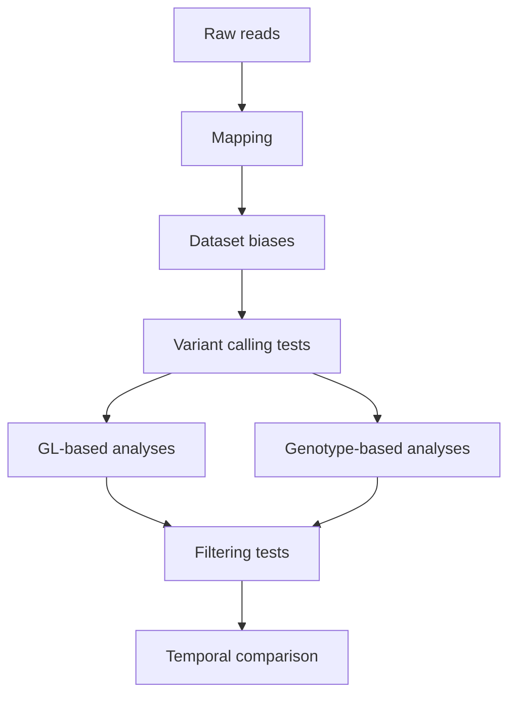

# MARKDOWN FOR OBP CHAPTER

Right, I started off with BAM files that had previously been mapped by Luke using `BWA mem` and `BWA aln` respectively.




## 3. BAM-LEVEL QC

### A. Quality control / Summary statistics

Check spreadsheet "BAM stats" for following stats: 

* mapping rate;
* duplicate rate;
* endogenous DNA content;
* mean and breadth of coverage;
* mapping-quality and base-quality distributions;
* fragment-length distributions;
* DNA-damage profiles for historical samples;
* contamination checks where feasible;
* sex inference;
* relatedness;
* sample identity and duplicate checks;
* mitochondrial coverage or haplotypes as an additional identity check;
* batch effects associated with library, sequencing run, historical/modern status or extraction protocol.

<details>
<summary> #####  SIDE TEST - REMOVE LOW QUALITY READS? (13/07/26) </summary>
I was debating wether to remove "low-quality" reads from the BAM files using `samtools view -q 20` but that filter was very harsh and was removing up to 30% reads. Additionally, I think using that filter is too harsh because historical genomes tend to have stronger reference bias and can map less sucesfully, so filtering by mapping quality can be harsh for historical DNA.\
I also considered using samtools flags like `-F 3844` to remove low quality alignments (e.g. unmapped reads and reads with unmapped mates, secondary alignments, QC-failed reads, duplicate reads) but those only seemed to remove <1% of reads so I considered it unnecessary. In conclusion, I decided it was best to keep the BAM files as they were and to filter later.
</details>

#### AMBER - PLOTTING MAPPING BIAS

There is a software called "AMBER" (https://github.com/tvandervalk/AMBER) which can plot different summary statistics. *Note: It can run max 6 BAM files at a time.*

To use it 

```bash
# Create BAM list file has two columns: first sample ID, second file path
module load python/3.12.8

DIR="/projects/erode/people/qhk515/01_OBP/data/raw_data/bams_OBP"
DIR_OUTPUT="/projects/erode/people/qhk515/01_OBP/data/raw_data/bams_OBP/AMBER_QC"
DIR_AMBER="/projects/erode/people/qhk515/software/AMBER"
mkdir -p $DIR_OUTPUT

cd $DIR

# Make a list of 6 samples
paste <(basename -a *bam ) <(realpath *bam) | tail -n 6 > ${DIR_OUTPUT}/BAM_AMBER.list

# Make a list of scaffolds to exclude
seq 2 2002 | sed 's/^/scaffold_/' > ${DIR_OUTPUT}/scaffolds.list

# RUN AMBER 
cd $DIR_AMBER
python -m amber --bamfiles ${DIR_OUTPUT}/BAM_AMBER.list --output ${DIR_OUTPUT}/AMBER_QC --exclude ${DIR_OUTPUT}/scaffolds.list

```

#### QUALIMAP 2 

```bash
# Run Qualimap independently

#!/bin/bash
#SBATCH --job-name=qualimap
#SBATCH --partition=cpuqueue
#SBATCH --qos=normal
#SBATCH --cpus-per-task=8
#SBATCH --mem=20G 
#SBATCH --time=24:00:00
#SBATCH --output=jobs/%x_%j.out
#SBATCH --error=jobs/%x_%j.err

set -euo pipefail

module purge
module load qualimap/2.3 java-jdk/8.0.112
 
 timestamp() { date '+%F %T'; }

# Set directory
DIR=$1

cd $DIR

shopt -s nullglob

OUTDIR="qualimap_reports"
mkdir -p "${OUTDIR}" jobs

for file in ${DIR}/*.bam; do
  sample=$(basename "${file}" .bam)
  
  REPORT_DIR="${OUTDIR}/${sample}_qualimap"

  echo "[$(timestamp)] Running Qualimap for BAM: ${file}"

# Run Qualimap (skip if already done)
  qualimap bamqc \
    -bam "${file}" \
    -outdir "${REPORT_DIR}" \
    -nt "${SLURM_CPUS_PER_TASK}" \
    --java-mem-size=16G

echo "[$(date)] Done for $file"

done 

echo "[$(timestamp)] All Qualimap jobs complete"

exit 0


#Then run MultiQC to aggregate results
module purge
module load qualimap/2.3 java-jdk/8.0.112

 
INDIR="/projects/erode/people/qhk515/01_OBP/data/raw_data/bams_OBP/qualimap_reports"
OUTDIR="/projects/erode/people/qhk515/01_OBP/data/raw_data/bams_OBP/qualimap_reports/multiqc"
mkdir -p $OUTDIR 

# Create a list of the bam qc results (three columns: sample, path, group)
paste <(basename -a *qualimap | sed 's/_qualimap//') <(realpath *qualimap) > ${INDIR}/bam.list
awk 'BEGIN{OFS="\t"} /^O-/  {print $1, $2, "Modern"; next} /^OBP/ {print $1, $2, "Historical"}' ${INDIR}/bam.list > ${INDIR}/bam_group.list

qualimap multi-bamqc \
--data ${INDIR}/bam_group.list \
-outdir $OUTDIR \
-outfile multiqc_OBP \
-outformat PDF:HTML

# Or you can also manually summarise the QC reports

# RUN AFTER:

REPORT_DIR="."
OUT_TSV="${REPORT_DIR}/qualimap_summary.tsv"

echo -e "SampleID\tTotalReads\tMappedReads\tMappingQuality\tMeanCoverage\tStdDevCoverage\tDuplicationRate\tMeanInsertSize\tPctGenome_2x\tPctGenome_5x\tPctGenome_10x" > "${OUT_TSV}"

for report in "${REPORT_DIR}"/*_qualimap/; do
  STATS="${report}/genome_results.txt"
  [[ ! -s "${STATS}" ]] && continue

  SAMPLE=$(basename "${report}" | sed 's/_qualimap$//')

  TOTAL_READS=$(grep "number of reads =" "${STATS}" | awk -F' = ' '{print $2}' | tr -d ',')
  MAPPED_READS=$(grep "number of mapped reads =" "${STATS}" | awk -F' = ' '{print $2}' | tr -d ',')
  MAPQ=$(grep "mean mapping quality =" "${STATS}" | awk -F' = ' '{print $2}')
  MEAN_COV=$(grep "mean coverageData" "${STATS}" | awk -F' = ' '{print $2}')
  STD_COV=$(grep "std coverageData" "${STATS}" | awk -F' = ' '{print $2}')
  DUP_RATE=$(grep "duplication rate" "${STATS}" | awk -F' = ' '{print $2}' | tr -d '% ')
  INSERT_SIZE=$(grep "mean insert size =" "${STATS}" | awk -F' = ' '{print $2}')

  COV2=$(grep "coverageData >= 2X" "${STATS}" | awk '{print $4}' | tr -d '%')
  COV5=$(grep "coverageData >= 5X" "${STATS}" | awk '{print $4}' | tr -d '%')
  COV10=$(grep "coverageData >= 10X" "${STATS}" | awk '{print $4}' | tr -d '%')

  echo -e "${SAMPLE}\t${TOTAL_READS:-NA}\t${MAPPED_READS:-NA}\t${MAPQ:-NA}\t${MEAN_COV:-NA}\t${STD_COV:-NA}\t${DUP_RATE:-NA}\t${INSERT_SIZE:-NA}\t${COV2:-NA}\t${COV5:-NA}\t${COV10:-NA}" \
    >> "${OUT_TSV}"
done

echo "[DONE] Wrote ${OUT_TSV}"


# Later in R -> see R script on local device

```

#### Reference genome summary metrics

```bash
# Get summary of ref genome metrics
# Get scaffold lengths and cumulative positions from the reference genome index
awk '
BEGIN {
    OFS="\t"
    print "Scaffold", "Length", "Cumulative_start", "Cumulative_end", \
          "Start_percent", "End_percent"
}

{
    scaffold_length = $2

    cumulative_start = cumulative
    cumulative_end   = cumulative + scaffold_length
    cumulative       = cumulative_end

    names[NR]   = $1
    lengths[NR] = scaffold_length
    starts[NR]  = cumulative_start
    ends[NR]    = cumulative_end
}

END {
    total = cumulative

    for (i = 1; i <= NR; i++) {
        print names[i], \
              lengths[i], \
              starts[i], \
              ends[i], \
              100 * starts[i] / total, \
              100 * ends[i] / total
    }
}
' bNeochry1.pri.20230906.fa.fai > scaffold_reference_positions.tsv

# Later in R
# Install packages if required
# install.packages(c("tidyverse", "scales"))

library(tidyverse)
library(scales)

# Read scaffold positions
scaffolds <- read_tsv(
  "scaffold_reference_positions.tsv",
  show_col_types = FALSE
)

# Preserve the scaffold order from the FASTA index
scaffolds <- scaffolds %>%
  mutate(
    Scaffold = factor(Scaffold, levels = Scaffold),
    group = row_number() %% 2
  )

# Plot the reference genome as one continuous bar
ggplot(scaffolds) +
  geom_rect(
    aes(
      xmin = Cumulative_start,
      xmax = Cumulative_end,
      ymin = 0,
      ymax = 1,
      fill = factor(group)
    ),
    colour = NA
  ) +
  scale_x_continuous(
    labels = label_number(
      scale = 1e-6,
      suffix = " Mb"
    ),
    expand = expansion(mult = c(0, 0))
  ) +
  scale_fill_manual(
    values = c("grey35", "grey70"),
    guide = "none"
  ) +
  coord_cartesian(ylim = c(0, 1)) +
  labs(
    title = "Orange-bellied parrot reference genome",
    subtitle = "Scaffolds arranged in FASTA index order",
    x = "Cumulative genome position",
    y = NULL
  ) +
  theme_classic() +
  theme(
    axis.text.y = element_blank(),
    axis.ticks.y = element_blank(),
    axis.line.y = element_blank(),
    plot.title = element_text(face = "bold")
  )


# Calculate length of callable genome
REF="/projects/erode/people/qhk515/reference_genomes/OBP/bNeochry1.pri.20230906.fa.fai"
LIST="OBP_scaffolds_ge100kb.list"

awk '
NR == FNR {
    keep[$1] = 1
    next
}

{
    total += $2

    if ($1 in keep) {
        kept += $2
        n++
    }
}

END {
    printf "Scaffolds in list: %d\n", n
    printf "Length retained: %d bp\n", kept
    printf "Reference length: %d bp\n", total

    if (total > 0)
        printf "Percentage retained: %.2f%%\n", 100 * kept / total
    else
        print "ERROR: reference length is zero; check that REF is a .fai file" > "/dev/stderr"
}
' "$LIST" "$REF"
```

### B. Sex identification

Silver et al. (2025) determined scaffold 5 as the sex chromosome. We did a test to identiy if there were other sex-linked scaffolds.

1. Calculate mean depth for every scaffold in every sample.
2. Normalise each scaffold by that sample’s autosomal depth.
3. Use scaffold_5 as the provisional Z chromosome to classify individuals.
4. Compare the inferred males and females across every scaffold.
5. Identify additional Z- and W-linked scaffolds.

```bash
#!/bin/bash
#SBATCH --job-name=sex_scaffolds
#SBATCH --partition=cpuqueue
#SBATCH --cpus-per-task=2
#SBATCH --time=12:00:00
#SBATCH --output=jobs/%x_%j.out
#SBATCH --error=jobs/%x_%j.err
#SBATCH --mail-type=END,FAIL
#SBATCH --mail-user=amb230@kent.ac.uk

# SCRIPT TO DETERMINE SEX AND IDENTIFY SEX-LINKED SCAFFOLDS

# ==============================================================================
# This script:
#
#   1. Calculates mean sequencing depth for every scaffold in each BAM file.
#   2. Calculates a length-weighted mean autosomal depth for each sample.
#   3. Normalises the depth of a known or suspected sex-linked scaffold (in this study scaffold_5)
#      against autosomal depth.
#   4. Assigns provisional avian sex classes:
#          male_ZZ:    normalised Z depth expected near 1.0
#          female_ZW:  normalised Z depth expected near 0.5
#          ambiguous:  normalised Z depth below the expected female range
#   5. Normalises the depth of every scaffold within each sample.
#   6. Compares mean scaffold depth between provisional males and females to
#      identify additional candidate Z- and W-linked scaffolds.

# Input:
#   - All BAM files located directly within BAM_DIR.

# Main outputs:
#
#   sex_results.tsv
#       Per-sample autosomal depth, sex-scaffold depth, normalised depth,
#       and provisional sex assignment.
#
#   all_normalised_depths.tsv
#       Mean and normalised depth for every scaffold in every sample.
#
#   possible_sex_linked_scaffolds.tsv
#       Mean normalised scaffold depth in provisional males and females,
#       the female-to-male depth ratio, and scaffold classification.
# ==============================================================================

set -euo pipefail

export LC_NUMERIC=C # Standardise numeric formatting between Bash and awk.

module load samtools/1.21


# ============================================================
# USER SETTINGS (EDIT)
# ============================================================

# Directory containing the input BAM files.
BAM_DIR="/projects/erode/people/qhk515/01_OBP/data/raw_data/bams_OBP"

# Directory in which all results and intermediate files will be written.
OUT_DIR="/projects/erode/scratch/OBP/sex_scaffold_analysis"

# Known or suspected Z-linked scaffold used for the initial sex assignment.
SEX_SCAFFOLD="scaffold_5"

# Mitochondrial scaffold, excluded from the autosomal depth calculation
MITO_SCAFFOLD="scaffold_1904"

# Minimum scaffold length, in base pairs
MIN_LENGTH=100000

# Minimum mapping quality passed to samtools coverage.
MIN_MAPQ=0

# Female if scaffold_5/autosomal depth is below this value
THRESHOLD=0.75


# ============================================================
# PREPARE OUTPUT
# ============================================================
mkdir -p "${OUT_DIR}/coverage"
mkdir -p "${OUT_DIR}/normalised"

# Main table containing the provisional sex assignment for every sample.
SEX_RESULTS="${OUT_DIR}/sex_results.tsv"

# Combined table containing the normalised depth of every scaffold in every sample.
ALL_DEPTHS="${OUT_DIR}/all_normalised_depths.tsv"

# Initialise the sex-results table and write its column names.
#
# Columns:
#   Sample            Sample identifier derived from the BAM filename
#   Autosomal_depth   Length-weighted mean depth across selected autosomes
#   Scaffold_5_depth  Mean depth of the putative Z-linked scaffold
#   Normalised_depth  Scaffold_5 depth divided by autosomal depth
#   Predicted_sex     Provisional sex assignment
printf "Sample\tAutosomal_depth\tScaffold_5_depth\tNormalised_depth\tPredicted_sex\n" \
    > "${SEX_RESULTS}"

# Initialise the combined scaffold-depth table and write its column names.
#
# Columns:
#   Sample             Sample identifier
#   Scaffold           Scaffold name
#   Length             Scaffold length in base pairs
#   Mean_depth         Mean sequencing depth reported by samtools coverage
#   Autosomal_depth    Sample-specific autosomal depth
#   Normalised_depth   Scaffold depth divided by autosomal depth
printf "Sample\tScaffold\tLength\tMean_depth\tAutosomal_depth\tNormalised_depth\n" \
    > "${ALL_DEPTHS}"


# ============================================================
# PROCESS EACH BAM
# ============================================================

# Process every BAM file found directly within BAM_DIR.
for BAM in "${BAM_DIR}"/*.bam; do

    # Derive the sample identifier by removing the .bam suffix.
    SAMPLE=$(basename "${BAM}" .bam)

    echo "Processing ${SAMPLE}"

    # Per-sample samtools coverage output.
    COVERAGE_FILE="${OUT_DIR}/coverage/${SAMPLE}.coverage.tsv"

    # Per-sample normalised scaffold-depth output.
    NORMALISED_FILE="${OUT_DIR}/normalised/${SAMPLE}.normalised.tsv"


    # --------------------------------------------------------
    # Check that the BAM is indexed
    # --------------------------------------------------------
    if [[ ! -f "${BAM}.bai" && ! -f "${BAM%.bam}.bai" ]]; then
        echo "Indexing ${SAMPLE}"
        samtools index "${BAM}"
    fi


    # --------------------------------------------------------
    # Calculate mean depth for every scaffold
    # --------------------------------------------------------
    samtools coverage \
        -q "${MIN_MAPQ}" \
        "${BAM}" \
        > "${COVERAGE_FILE}"


    # --------------------------------------------------------
    # Calculate autosomal depth
    # --------------------------------------------------------

    # Calculate a sample-specific autosomal depth baseline.
    # For each eligible scaffold:
    #   depth contribution = scaffold mean depth × scaffold length
    # The final autosomal depth is:
    #   sum(depth × length) / sum(length)
    # This weights long scaffolds more heavily than short scaffolds and
    # approximates mean depth across the selected autosomal sequence.
    AUTOSOMAL_DEPTH=$(
    awk \
        -v sex_scaffold="${SEX_SCAFFOLD}" \
        -v mito_scaffold="${MITO_SCAFFOLD}" \
        -v min_length="${MIN_LENGTH}" '
    BEGIN {
        # samtools coverage output is tab-delimited.
        FS = "\t"
    }

    # Skip the samtools coverage header.
    /^#/ {
        next
    }

    {
        # Extract scaffold name, covered interval length and mean depth.
        scaffold = $1
        scaffold_length = $3 - $2 + 1
        mean_depth = $7

        # Include only sufficiently long presumed autosomal scaffolds.
        if (scaffold != sex_scaffold &&
            scaffold != mito_scaffold &&
            scaffold_length >= min_length) {

            depth_sum += mean_depth * scaffold_length
            length_sum += scaffold_length
        }
    }

    END {
        # Report the length-weighted mean if at least one eligible
        # scaffold was identified.
        if (length_sum > 0) {
            printf "%.6f", depth_sum / length_sum
        } else {
            print "NA"
        }
    }
    ' "${COVERAGE_FILE}"
)

    # Stop the script if no eligible autosomal scaffolds were available.
    if [[ "${AUTOSOMAL_DEPTH}" == "NA" ]]; then
        echo "ERROR: Could not calculate autosomal depth for ${SAMPLE}"
        exit 1
    fi


    # --------------------------------------------------------
    # Get scaffold_5 depth
    # --------------------------------------------------------

    # Extract the mean depth reported in column 7 for the putative
    # Z-linked scaffold.
    SEX_DEPTH=$(
        awk -v sex_scaffold="${SEX_SCAFFOLD}" '
        BEGIN {
            FS="\t"
        }

        !/^#/ && $1 == sex_scaffold {
            print $7
        }
        ' "${COVERAGE_FILE}"
    )


    # Skip the sample if the specified sex scaffold is absent from the
    # samtools coverage output.
    if [[ -z "${SEX_DEPTH}" ]]; then
        echo "WARNING: ${SEX_SCAFFOLD} was not found for ${SAMPLE}"
        continue
    fi


    # --------------------------------------------------------
    # Normalise scaffold_5 depth
    # --------------------------------------------------------

    # Calculate:
    #
    #   normalised Z depth = scaffold_5 mean depth / autosomal mean depth
    #
    # Under the expected avian ZW system:
    #
    #   male ZZ   approximately 1.0
    #   female ZW approximately 0.5
    NORMALISED_SEX_DEPTH=$(
        awk \
            -v sex_depth="${SEX_DEPTH}" \
            -v autosomal_depth="${AUTOSOMAL_DEPTH}" '
        BEGIN {
            printf "%.4f", sex_depth/autosomal_depth
        }
        '
    )


    # --------------------------------------------------------
    # Predict sex
    # --------------------------------------------------------

    # Assign provisional sex using the normalised Z-depth ratio:
    #
    #   ratio >= 0.75:
    #       male_ZZ
    #
    #   ratio >= 0.30 and < 0.75:
    #       female_ZW
    #
    #   ratio < 0.30:
    #       ambiguous
    #
    # The ambiguous category prevents samples with unexpectedly low
    # scaffold_5 coverage from automatically being classified as female.
    PREDICTED_SEX=$(
    awk \
        -v ratio="${NORMALISED_SEX_DEPTH}" '
    BEGIN {
        if (ratio >= 0.75) {
            print "male_ZZ"
        }
        else if (ratio >= 0.30 && ratio < 0.75) {
            print "female_ZW"
        }
        else {
            print "ambiguous"
        }
    }
    '
)


    # --------------------------------------------------------
    # Write sex result
    # --------------------------------------------------------

    # Append the current sample's results to the combined sex-results table.
    printf "%s\t%.4f\t%.4f\t%.4f\t%s\n" \
        "${SAMPLE}" \
        "${AUTOSOMAL_DEPTH}" \
        "${SEX_DEPTH}" \
        "${NORMALISED_SEX_DEPTH}" \
        "${PREDICTED_SEX}" \
        >> "${SEX_RESULTS}"


    # --------------------------------------------------------
    # Normalise every scaffold
    # --------------------------------------------------------

    # Initialise a separate normalised-depth table for the current sample.
    printf "Sample\tScaffold\tLength\tMean_depth\tAutosomal_depth\tNormalised_depth\n" \
        > "${NORMALISED_FILE}"

    # For every scaffold, calculate:
    #
    #   normalised depth = scaffold mean depth / autosomal mean depth
    #
    # This table is subsequently used to compare scaffold-level depth
    # between samples classified as male and female.
    awk -v sample="$SAMPLE" -v autosomal_depth="$AUTOSOMAL_DEPTH" \
'BEGIN{FS=OFS="\t"} /^#/{next} {scaffold=$1; scaffold_length=$3-$2+1; mean_depth=$7; normalised_depth=mean_depth/autosomal_depth; print sample,scaffold,scaffold_length,mean_depth,autosomal_depth,normalised_depth}' \
"$COVERAGE_FILE" >> "$NORMALISED_FILE"

    # Add the sample's scaffold results to the combined table while
    # excluding the per-sample header line.
    tail -n +2 "${NORMALISED_FILE}" >> "${ALL_DEPTHS}"

    # Print a concise summary to the Slurm standard-output log.
    echo "  Autosomal depth: ${AUTOSOMAL_DEPTH}"
    echo "  ${SEX_SCAFFOLD} depth: ${SEX_DEPTH}"
    echo "  Normalised depth: ${NORMALISED_SEX_DEPTH}"
    echo "  Predicted sex: ${PREDICTED_SEX}"

done


# ============================================================
# FINISHED
# ============================================================

# Report the locations of the two main files generated during the
# per-sample processing stage.
echo
echo "Finished."
echo "Sex results: ${SEX_RESULTS}"
echo "All normalised scaffold depths: ${ALL_DEPTHS}"


# =================================================
# SEARCH FOR OTHER POSSIBLE SEX-LINKED SCAFFOLDS
# ============================================================

# Output table containing group-level depth summaries and provisional
# sex-linkage classifications.
SEX_LINKED_RESULTS="${OUT_DIR}/possible_sex_linked_scaffolds.tsv"

# Initialise the candidate-scaffold output.
#
# This file is subsequently overwritten by the awk pipeline below,
# which also writes its own header.
printf "Scaffold\tLength\tMale_mean\tFemale_mean\tFemale_to_male\tClassification\n" \
    > "${SEX_LINKED_RESULTS}"

# Read two input files:
#
#   1. SEX_RESULTS:
#      provides the provisional sex assigned to each sample.
#
#   2. ALL_DEPTHS:
#      provides normalised depth for every sample and scaffold.
#
# The script then calculates mean normalised depth separately for
# provisional males and females.
awk '
BEGIN {
    FS = OFS = "\t"
}

# Read predicted sex from the first file
#
# NR == FNR is true while awk is reading the first input file.
NR == FNR {
    # Skip the sex-results header.
    if (FNR == 1) {
        next
    }

    # Store the predicted sex using the sample identifier as the key.
    sample_sex[$1] = $5
    next
}

# Skip the header of the second file
FNR == 1 {
    next
}

{
    # Extract sample, scaffold, scaffold length and normalised depth.
    sample = $1
    scaffold = $2
    scaffold_length[scaffold] = $3
    normalised_depth = $6

    # Accumulate normalised depth separately for provisional males
    # and provisional females.
    #
    # Samples classified as ambiguous are not included in either group.
    if (sample_sex[sample] == "male_ZZ") {
        male_sum[scaffold] += normalised_depth
        male_count[scaffold]++
    }
    else if (sample_sex[sample] == "female_ZW") {
        female_sum[scaffold] += normalised_depth
        female_count[scaffold]++
    }
}

END {
    # Write the candidate-scaffold table header.
    print "Scaffold", "Length", "Male_mean", "Female_mean", \
          "Female_male_ratio", "Classification"

    # Summarise each scaffold observed in the combined depth table.
    for (scaffold in scaffold_length) {

                # Exclude scaffolds shorter than 100 kb from the
                # candidate sex-linkage screen.
				if (scaffold_length[scaffold] < 100000) {
    			continue
				}

        # A male-to-female comparison cannot be made unless the scaffold
        # has observations from at least one sample in each group.
        if (male_count[scaffold] == 0 || female_count[scaffold] == 0) {
            continue
        }

        # Calculate group mean normalised depth.
        male_mean = male_sum[scaffold] / male_count[scaffold]
        female_mean = female_sum[scaffold] / female_count[scaffold]

        # Default values before applying sex-linkage criteria.
        ratio = "NA"
        classification = "autosomal_or_unknown"

        # Avoid division by zero when calculating the female-to-male ratio.
        if (male_mean > 0) {
            ratio = female_mean / male_mean
        }

        # Candidate Z-linked scaffolds are expected to have:
        #
        #   male normalised depth:   0.75–1.25
        #   female normalised depth: 0.25–0.75
        #   female/male ratio:       0.30–0.70
        if (male_mean >= 0.75 && male_mean <= 1.25 && \
            female_mean >= 0.25 && female_mean <= 0.75 && \
            ratio >= 0.30 && ratio <= 0.70) {

            classification = "possible_Z_linked"
        }

        # Candidate W-linked scaffolds are expected to have:
        #
        #   male normalised depth:   <= 0.10
        #   female normalised depth: >= 0.20
        #
        # This is an exploratory classification and does not itself
        # confirm that a scaffold is W-linked.
        else if (male_mean <= 0.10 && female_mean >= 0.20) {
            classification = "possible_W_linked"
        }

        # Write one result per scaffold.
        printf "%s\t%s\t%.4f\t%.4f\t%s\t%s\n", \
               scaffold, scaffold_length[scaffold], \
               male_mean, female_mean, ratio, classification
    }
}

# First input: provisional sex assignments.
# Second input: combined normalised scaffold depths.
' "${SEX_RESULTS}" "${ALL_DEPTHS}" |

# Preserve the header and sort the remaining records:
#
#   primary key:   classification, alphabetically
#   secondary key: scaffold length, largest first
{
    IFS= read -r header
    printf '%s\n' "$header"
    sort -t $'\t' -k6,6 -k2,2nr
} > "${SEX_LINKED_RESULTS}"

# Print the final result location to the Slurm log.
echo "Possible sex-linked scaffolds: ${SEX_LINKED_RESULTS}"


exit 0

# Later in R

setwd("~/Library/CloudStorage/OneDrive-UniversityofKent/PhD stuff/PhD research/Research projects/01_OBP/Analyses/Sex_identification")

library(tidyverse)
library(ggplot2)
library(ggrepel) # For labels
library(readr)

# ============================================================
# INPUT FILES
# ============================================================

sex_file <- "sex_results.tsv"
depth_file <- "all_normalised_depths.tsv"
candidate_file <- "possible_sex_linked_scaffolds.tsv"

# Candidate scaffolds to examine
candidate_scaffolds <- c(
  "scaffold_5",
  "scaffold_53",
  "scaffold_196"
)

# ============================================================
# READ DATA
# ============================================================

sex_results <- read_tsv(
  sex_file,
  show_col_types = FALSE
)

all_depths <- read_tsv(
  depth_file,
  show_col_types = FALSE
)

candidate_results <- read_tsv(
  candidate_file,
  show_col_types = FALSE
)

# Add the predicted sex to the individual-level scaffold-depth data
plot_data <- all_depths %>%
  left_join(
    sex_results %>% select(Sample, Predicted_sex),
    by = "Sample"
  )

# Set a consistent order for sex categories
plot_data <- plot_data %>%
  mutate(
    Predicted_sex = factor(
      Predicted_sex,
      levels = c("male_ZZ", "female_ZW", "ambiguous")
    )
  )


# PLot individual depths
candidate_depths <- plot_data %>%
  filter(
    Scaffold %in% candidate_scaffolds,
    Predicted_sex != "ambiguous"
  ) %>%
  mutate(
    Scaffold = factor(
      Scaffold,
      levels = candidate_scaffolds
    )
  )

candidate_plot <- ggplot(
  candidate_depths,
  aes(
    x = Predicted_sex,
    y = Normalised_depth
  )
) +
  geom_boxplot(
    outlier.shape = NA,
    width = 0.55
  ) +
  geom_jitter(
    width = 0.12,
    height = 0,
    size = 2,
    alpha = 0.8
  ) +
  geom_hline(
    yintercept = 1,
    linetype = "dashed"
  ) +
  geom_hline(
    yintercept = 0.5,
    linetype = "dotted"
  ) +
  facet_wrap(
    ~ Scaffold,
    nrow = 1
  ) +
  labs(
    x = "Predicted sex",
    y = "Normalised scaffold depth",
    title = "Individual coverage patterns for candidate Z-linked scaffolds",
    subtitle = "Expected Z-linked depth: males ≈ 1 and females ≈ 0.5"
  ) +
  theme_bw() +
  theme(
    axis.text.x = element_text(
      angle = 30,
      hjust = 1
    )
  )

candidate_plot

ggsave(
  "candidate_Z_scaffold_individual_depths.png",
  candidate_plot,
  width = 11,
  height = 5
)


# HEATMAP CREATION
# ============================================================
# HEATMAP OF NORMALISED DEPTH ACROSS SEX-LINKED AND CONTROL SCAFFOLDS
# ============================================================

library(tidyverse)

# ------------------------------------------------------------
# Input files
# ------------------------------------------------------------

sex_file <- "sex_results.tsv"
depth_file <- "all_normalised_depths.tsv"
candidate_file <- "possible_sex_linked_scaffolds.tsv"


# ------------------------------------------------------------
# Select scaffolds
# ------------------------------------------------------------

selected_scaffolds <- c(
  "scaffold_1",
  "scaffold_5",
  "scaffold_53",
  "scaffold_196"
)

selected_scaffolds

# ------------------------------------------------------------
# Prepare heatmap data
# ------------------------------------------------------------

heatmap_data <- all_depths %>%
  filter(Scaffold %in% selected_scaffolds) %>%
  left_join(
    sex_results %>%
      select(
        Sample,
        Predicted_sex,
        Sex_scaffold_depth = Normalised_depth
      ),
    by = "Sample"
  ) %>%
  mutate(
    Predicted_sex = factor(
      Predicted_sex,
      levels = c("male_ZZ", "female_ZW", "ambiguous")
    )
  )


# ------------------------------------------------------------
# Order samples
# ------------------------------------------------------------

sample_order <- sex_results %>%
  pull(Sample)

heatmap_data <- heatmap_data %>%
  mutate(
    Sample = factor(
      Sample,
      levels = rev(sample_order)
    )
  )


# ------------------------------------------------------------
# Order scaffolds
# ------------------------------------------------------------

heatmap_data <- heatmap_data %>%
  mutate(
    Scaffold = factor(
      Scaffold,
      levels = c(
        "scaffold_1",
        "scaffold_5",
        "scaffold_53",
        "scaffold_196"
      )
    )
  )


# ------------------------------------------------------------
# Plot heatmap
# ------------------------------------------------------------

depth_heatmap <- ggplot(
  heatmap_data,
  aes(
    x = Scaffold,
    y = Sample,
    fill = Normalised_depth
  )
) +
  geom_tile(
    colour = "white",
    linewidth = 0.2
  ) +
  scale_fill_viridis_c(
    option = "magma",
    limits = c(0, 1.5),
    oob = scales::squish,
    breaks = c(0, 0.5, 1.0, 1.5),
    name = "Normalised\ndepth"
  ) +
  facet_grid(
    Predicted_sex ~ .,
    scales = "free_y",
    space = "free_y",
    switch = "y"
  ) +
  labs(
    x = "Scaffold",
    y = "Sample",
    title = "Normalised scaffold depth across Orange-bellied Parrot samples",
    subtitle = paste(
      "Control autosomal scaffold (scaffold 1) and candidate sex-linked scaffolds;"
    )
  ) +
  theme_bw() +
  theme(
    panel.grid = element_blank(),
    strip.background = element_rect(fill = "grey95"),
    strip.placement = "outside",
    axis.text.x = element_text(
      angle = 45,
      hjust = 1,
      size = 12
    ),
    axis.text.y = element_text(size = 12),
    legend.position = "right"
  )

depth_heatmap


ggsave(
  filename = "normalised_depth_sex_scaffold_heatmap.png",
  plot = depth_heatmap,
  width = 11,
  height = 10,
  dpi = 300
)


```

### C. Relatedness

I ran NGSrelate three times to avoid temporal structural biases: 1) All samples (N=35) 2) Modern samples only (N=19) 3) Historical only (N=16).\
Then I checked the kinship coefficients in R

```bash
#!/bin/bash
#SBATCH --job-name=ngsrelate_combined_35
#SBATCH --error=jobs/%x_%j.err
#SBATCH --output=jobs/%x_%j.log
#SBATCH --time=24:00:00
#SBATCH --partition=cpuqueue
#SBATCH --qos=normal
#SBATCH --cpus-per-task=8
#SBATCH --mail-type=END,FAIL
#SBATCH --mail-user=amb230@kent.ac.uk

set -euo pipefail
timestamp() { date '+%F %T'; }

# ========= MODULES =========
module purge

module load angsd/0.940 ngsrelate/2.0  # or whatever the module is called

# VARIABLES
REF="/projects/erode/people/qhk515/reference_genomes/OBP/bNeochry1.pri.20230906.fa"
BAM_LIST="/projects/erode/people/qhk515/01_OBP/data/OBP_bam_35.list"
AUTOSOMES="/projects/erode/people/qhk515/01_OBP/data/OBP_scaffolds_ge100kb.list"
OUTDIR="/projects/erode/scratch/OBP/ngsrelate/"
FREQS="${OUTDIR}/OBP_combined_35.freqs"
RESULTS_PREFIX="${OUTDIR}/OBP_combined_35"
mkdir -p $OUTDIR

# Minimum individuals
N=$(wc -l < "${BAM_LIST}")
PERCENT_IND=90
MIN_IND=$(( (N * PERCENT_IND + 99) / 100 ))

# ========= STEP 1: ANGSD – genotype likelihoods + MAFs =========
echo "$(timestamp) Starting ANGSD for $RESULTS_PREFIX"

### First we generate a file with allele frequencies (angsdput.mafs.gz) and a file with genotype likelihoods (angsdput.glf.gz).
angsd -nThreads $SLURM_CPUS_PER_TASK -ref ${REF} -rf $AUTOSOMES -bam $BAM_LIST -out ${RESULTS_PREFIX} -gl 2 -domajorminor 1 -snp_pval 1e-6 -domaf 1 -minmaf 0.05 -doGlf 3 -uniqueOnly 1 -remove_bads 1 -C 50  -only_proper_pairs 1 -skipTriallelic 1 -minMapQ 30 -minQ 20 -minInd $MIN_IND -rmTrans 1

echo "$(timestamp) Finished running ANGSD"

N_SITES=$(zcat ${RESULTS_PREFIX}.mafs.gz | tail -n +2 | wc -l)
echo "Number of variable sites (no header): ${N_SITES}"


# ========= STEP 2: Make frequency file for NgsRelate =========
### Then we extract the frequency column from the allele frequency file and remove the header (to make it in the format NgsRelate needs)
zcat ${RESULTS_PREFIX}.mafs.gz | cut -f 6 | sed 1d > $FREQS


# ========= STEP 3: Make ID file (sample labels) =========
# To ensure that NgsRelate results have sample labels
IDS_FILE="${RESULTS_PREFIX}.ids"

echo "[$(timestamp)] Creating IDs file from BAM list…"

# If it’s just paths, you can use basename instead.
for line in $(cat "${BAM_LIST}"); do
  basename "${line}" ".rmdup.bam"
done > "${IDS_FILE}"


### run NgsRelate
ngsRelate -g ${RESULTS_PREFIX}.glf.gz -p $SLURM_CPUS_PER_TASK -n $N -f $FREQS -O ${RESULTS_PREFIX}.ngsrelate -z $IDS_FILE

echo "$(timestamp) Finished running NGSrelate"
echo "Done"


exit 0

#Later in R

library(tidyverse)
library(ggplot2)
library("Matrix")
library("corrplot")

setwd("~/Library/CloudStorage/OneDrive-UniversityofKent/PhD stuff/PhD research/Research projects/01_OBP/Analyses/Relatedness")


list.files() #see what files are available to read

# Read in files
base_name <- "OBP_combined_35"
#base_name <- "OBP_mod_19"
#base_name <- "OBP_hist_16"


rel_ce <- read.table(paste0(base_name, ".ngsrelate"), header = TRUE)
Names <- scan(paste0(base_name,".ids"), what = "character")
N_sites <- rel_ce$nSites[1]

# NGSrelate indices are 0-based; convert to 1-based for R
rel_ce$a <- rel_ce$a + 1L
rel_ce$b <- rel_ce$b + 1L

# Build theta matrix
n <- length(Names)

mat <- sparseMatrix(
  i        = rel_ce$a,
  j        = rel_ce$b,
  x        = rel_ce$theta,
  dims     = c(n, n),
  symmetric = TRUE
)

diag(mat) <- 0.5   # self-relatedness
mat <- as.matrix(mat)

colnames(mat) <- Names
rownames(mat) <- Names


# Plot relatedness heatmap
pdf(paste0(base_name,"_relatedness.pdf"), width = 8, height = 8)
corrplot(
  mat,
  tl.col  = "black",
  type    = "lower",
  tl.cex  = 0.95,
  tl.srt  = 45,
  pch.cex = 1.0,
  method  = "square",
  is.corr = FALSE
)
mtext(
  paste0("Relatedness among ", base_name, " OBP individuals (N_sites = ", N_sites, ")"),
  side = 1,   # bottom
  line = 4,
  cex = 1.1
)
dev.off()


# Extract related samples
rel_ce$name_a <- Names[rel_ce$a]
rel_ce$name_b <- Names[rel_ce$b]

# First-degree or closer (approx. theta >= 0.1875)
first_deg <- subset(rel_ce, theta >= 0.1875)
first_deg[, c("name_a", "name_b", "theta")]

# Second-degree (approx. 0.09375–0.1875)
second_deg <- subset(rel_ce,
                     theta >= 0.09375 & theta < 0.1875)
second_deg[, c("name_a", "name_b", "theta")]


```

## 4. Historical DNA biases

### A. MapDamage 

Run MapDamage on all samples

### B. Reference bias mapping 

Calculated using ANGSD

### C. HEARTY analysis

Study heterozygosity patterns 

### D. Dowsampled data (see other markdown file for this)

We also downsampled data to 5x to see if the behaviour of the samples was very different

## 7. VARIANT GENERATION

> I also did this pipeline with BAM files downsampled to 7x (using only indivudals that had an original mean coverage of >= 7x). See the Downsampling markdown for the pipeline used

### 7.1 ANGSD 

Due to the low coverage of some historical samples, we used ANGSD to generate genotype likelihood files. \
I am using two methodologies: 1) Luke's method 2) My method

#### 7.1.A. Luke's method

This script replicates the method to calculate heterozygosity using Lukes methods. I get pracitically the same heterozygosity values when I run this script.

```bash
#!/bin/bash
#SBATCH --job-name=Het_Luke
#SBATCH --time=72:00:00
#SBATCH --cpus-per-task=8
#SBATCH --qos=normal
#SBATCH --partition=cpuqueue
#SBATCH --output=jobs/%x_%j.out
#SBATCH --error=jobs/%x_%j.err
#SBATCH --mail-type=END,FAIL
#SBATCH --mail-user=amb230@kent.ac.uk

set -euo pipefail
timestamp() { date '+%F %T'; }

# === Load modules ===
module purge; module load angsd/0.940 winsfs/0.7.0

# === Inputs ====
LIST_COMBINED="/projects/erode/people/qhk515/01_OBP/data/OBP_bam_35.list"
LIST_HISTORICAL="/projects/erode/people/qhk515/01_OBP/data/OBP_bam_hist_16.list"
LIST_MODERN="/projects/erode/people/qhk515/01_OBP/data/OBP_bam_mod_19.list"
AUTOSOMAL_SCAFFOLDS="/projects/erode/people/qhk515/01_OBP/data/OBP_autosomes.list" # All scaffolds except scaffold_5 (sex chromosome)
REF="/projects/erode/people/qhk515/reference_genomes/OBP/bNeochry1.pri.20230906.fa"

OUTDIR="/projects/erode/people/qhk515/01_OBP/popgen_analyses/het/Luke_het"
mkdir -p ${OUTDIR}

cd ${OUTDIR}

# Making group lists (requieres at least data from 2 individuals to be included)
# Luke actually only used the combined list for the heterozygosity analysis
echo "$(timestamp) [*] Starting ANGSD for combined groups"
angsd -b ${LIST_COMBINED} -rf ${AUTOSOMAL_SCAFFOLDS} -ref ${REF} -anc ${REF} -out entire_genome_combined_nosex \
    -uniqueOnly 1 -remove_bads 1 -only_proper_pairs 1 -skipTriallelic 1 -rmTrans 1 \
    -C 50 -baq 0 -minMapQ 30 -minQ 20 -doCounts 1 -minInd 2 \
    -doMajorMinor 1 -GL 2 -doGlf 2 -doMaf 2 -nThreads ${SLURM_CPUS_PER_TASK} 

#echo "$(timestamp) [OK] ANGSD completed for combined group, starting modern and historical groups"
#angsd -b ${LIST_MODERN} -rf ${AUTOSOMAL_SCAFFOLDS} -ref ${REF} -anc ${REF} -out entire_genome_modern_nosex \
#    -uniqueOnly 1 -remove_bads 1 -only_proper_pairs 1 -skipTriallelic 1 -rmTrans 1 \
#    -C 50 -baq 0 -minMapQ 30 -minQ 20 -doCounts 1 -minInd 2 \
#    -doMajorMinor 1 -GL 2 -doGlf 2 -doMaf 2 -nThreads ${SLURM_CPUS_PER_TASK}

#echo "$(timestamp) [OK] ANGSD completed for modern group, starting historical group"
#angsd -b ${LIST_HISTORICAL} -rf ${AUTOSOMAL_SCAFFOLDS} -ref ${REF} -anc ${REF} -out entire_genome_historical_nosex \
#    -uniqueOnly 1 -remove_bads 1 -only_proper_pairs 1 -skipTriallelic 1 -rmTrans 1 \
#    -C 50 -baq 0 -minMapQ 30 -minQ 20 -doCounts 1 -minInd 2 \
#   -doMajorMinor 1 -GL 2 -doGlf 2 -doMaf 2 -nThreads ${SLURM_CPUS_PER_TASK}

echo "$(timestamp) [OK] Group lists created"

zcat entire_genome_combined_nosex.mafs.gz| awk '{print $1,$2}' | sed 1d > entire_genome_combined_nosex.list && angsd sites index entire_genome_combined_nosex.list
#zcat entire_genome_modern_nosex.mafs.gz| awk '{print $1,$2}' | sed 1d > entire_genome_modern_nosex.list && angsd sites index entire_genome_modern_nosex.list
#zcat entire_genome_historical_nosex.mafs.gz| awk '{print $1,$2}' | sed 1d > entire_genome_historical_nosex.list && angsd sites index entire_genome_historical_nosex.list

echo "$(timestamp) [OK] Group lists filtered to just positions created"


# Run ANGSD per indivudal
for BAM in $(cat ${LIST_COMBINED}); do
    NAME=$(basename "${BAM}" .rmdup.bam)
    echo "$(timestamp) [*] Starting ANGSD for individual ${NAME}"

    # Requierements (at least >4x coverage and <50x coverage per site to be included in the analysis)
    angsd -i ${BAM} -ref ${REF} -rf ${AUTOSOMAL_SCAFFOLDS} -anc ${REF} \
        -sites entire_genome_combined_nosex.list -out ${NAME}_nosex_filtlist \
        -uniqueOnly 1 -remove_bads 1 -only_proper_pairs 1 -noTrans 1 -C 50 \
        -baq 0 -minMapQ 30 -minQ 20 -setMinDepth 4 -setMaxDepth 50 -doCounts 1 -dumpCounts 3 \
        -nThreads ${SLURM_CPUS_PER_TASK} -GL 2 -doSaf 1

    echo "$(timestamp) [OK] ANGSD completed for ${NAME}"

    # Now convert calculate SFS and convert to wimSFS format 
    winsfs ${NAME}_nosex_filtlist.saf.idx > ${NAME}_filter_wim.ml

    echo "$(timestamp) [OK] winSFS completed for ${NAME}"
done

exit 0

```

##### Quality check

```bash

# To get summary het values across all individuals, run the following code after all jobs are done:

SUMMARY="heterozygosity_summary.tsv"
:> $SUMMARY

echo -e "sample\tn_boot\tmean_H\tsd_H\tmean_sites\tsd_sites" > "${SUMMARY}"

shopt -s nullglob

for file in *ml; do
  sample=$(basename "${file}" _filter_wim.ml)
  
  grep -v "SHAPE" "${file}" | awk -v sample="${sample}" '
    {
      tot = $1 + $2 + $3
      if (tot > 0) {
        h = $2 / tot
        n++

        sumH   += h
        sumsqH += h*h

        sumT   += tot
        sumsqT += tot*tot
      }
    }
    END {
      if (n == 0) {
        printf("%s\t0\tNA\tNA\tNA\tNA\n", sample)
        exit
      }

      meanH = sumH / n
      if (n > 1) {
        varH = (sumsqH - n*meanH*meanH) / (n-1)
        if (varH < 0) varH = 0
        sdH = sqrt(varH)
      } else {
        sdH = 0
      }

      meanT = sumT / n
      if (n > 1) {
        varT = (sumsqT - n*meanT*meanT) / (n-1)
        if (varT < 0) varT = 0
        sdT = sqrt(varT)
      } else {
        sdT = 0
      }

      printf("%s\t%d\t%.10f\t%.10f\t%.0f\t%.0f\n",
             sample, n, meanH, sdH, meanT, sdT)
    }' >> "${SUMMARY}"
done

echo "Wrote: ${SUMMARY}"


# SCRIPT - PART 2 CHECKS ====================================================================================
#!/bin/bash
set -euo pipefail

# Calculating the Overlap of combined with modern and historical lists 
combined_total=$(wc -l < entire_genome_combined_nosex.list)
modern_total=$(wc -l < entire_genome_modern_nosex.list)
historical_total=$(wc -l < entire_genome_historical_nosex.list)

combined_in_modern=$(comm -12 entire_genome_combined_nosex.list entire_genome_modern_nosex.list | wc -l)
combined_in_historical=$(comm -12 entire_genome_combined_nosex.list entire_genome_historical_nosex.list | wc -l)
modern_historical_intersect=$(comm -12 entire_genome_modern_nosex.list entire_genome_historical_nosex.list | wc -l)

combined_in_both=$(comm -12 <(comm -12 entire_genome_combined_nosex.list entire_genome_modern_nosex.list) \
                           <(comm -12 entire_genome_combined_nosex.list entire_genome_historical_nosex.list) | wc -l)

combined_modern_only=$(comm -23 entire_genome_combined_nosex.list entire_genome_historical_nosex.list | wc -l)
combined_historical_only=$(comm -23 entire_genome_combined_nosex.list entire_genome_modern_nosex.list | wc -l)

echo "combined_total	$combined_total"
echo "modern_total	$modern_total"
echo "historical_total	$historical_total"
echo "combined_in_modern	$combined_in_modern"
echo "combined_in_historical	$combined_in_historical"
echo "combined_in_both	$combined_in_both"
echo "combined_modern_only	$combined_modern_only"
echo "combined_historical_only	$combined_historical_only"
echo "modern_historical_intersect	$modern_historical_intersect"

# Calculating the per-indivudal representation in the combined list
sed 's#.*/##; s/.rmdup.bam$//' ${LIST_COMBINED} > beagle_sample_names.txt # Sample names

(
echo -e "sample\tindex\tinformative_sites\tmissing_sites\ttotal_sites\tinformative_fraction"
paste beagle_sample_names.txt <(
    zcat entire_genome_combined_nosex.beagle.gz | awk '
    BEGIN { OFS="\t" }
    NR==1 { next }
    {
        nind = (NF-3)/3
        for (i=1; i<=nind; i++) {
            c1 = 3 + (i-1)*3 + 1
            c2 = c1 + 1
            c3 = c1 + 2
            if ($c1 == 0.333333 && $c2 == 0.333333 && $c3 == 0.333333) {
                missing[i]++
            } else {
                informative[i]++
            }
            total[i]++
        }
    }
    END {
        for (i=1; i<=nind; i++) {
            frac = (total[i] > 0 ? informative[i]/total[i] : 0)
            print i, informative[i]+0, missing[i]+0, total[i]+0, frac
        }
    }'
)
) > beagle_per_individual_counts.tsv


# Calculate usable sites per indivudal ("How many sites from the combined list are actually usable per individual?”)
echo -e "sample\ttotal_sites" > per_individual_callable_sites.tsv

for f in *FINAL*.saf.idx; do
    name=$(basename "$f" .saf.idx)

    total=$(realSFS print "$f" 2>/dev/null | awk 'NF>=2 && $1 ~ /scaffold/ {n++} END{print n}')

    echo -e "${name}\t${total}" >> per_individual_callable_sites.tsv
done

exit 0

```

#### 7.1.B Standard ANGSD method - INDIVIDUAL

Then, I wrote what I thought would be the best approach to reduce group biases and coverage biases when running ANGSD.

It differs to Lukes script by:

- Only uses scaffolds >100kb
- individual max depth rather than a general cap at 50X to avoid low complexity sites (i.e. repetitive)

I based this script on Fontsere et al. 2025 (Whooping Crane paper).

```bash
#!/bin/bash
#SBATCH --job-name=Het_ANGSD
#SBATCH --time=03:00:00
#SBATCH --cpus-per-task=8
#SBATCH --qos=normal
#SBATCH --partition=cpuqueue
#SBATCH --array=1-35%5
#SBATCH --output=jobs/%x_%A_%a.log
#SBATCH --error=jobs/%x_%A_%a.err
#SBATCH --mail-type=END,FAIL
#SBATCH --mail-user=amb230@kent.ac.uk

set -euo pipefail

timestamp() { date '+%F %T'; }

# === Load modules ===
module purge; module load angsd/0.940 winsfs/0.7.0

# === Inputs ====
LIST_COMBINED="/projects/erode/people/qhk515/01_OBP/data/OBP_bam_35.list"
AUTOSOMAL_SCAFFOLDS="/projects/erode/people/qhk515/01_OBP/data/OBP_autosomes_ge100kb.list"
REF="/projects/erode/people/qhk515/reference_genomes/OBP/bNeochry1.pri.20230906.fa"
FILTERED_META="/projects/erode/people/qhk515/01_OBP/data/OBP_2x_meandepth.list"

OUTDIR="/projects/erode/people/qhk515/01_OBP/popgen_analyses/het/het_ANGSD_ind"
mkdir -p ${OUTDIR}

cd ${OUTDIR}

BAM=$(sed -n "${SLURM_ARRAY_TASK_ID}p" "${LIST_COMBINED}")
NAME=$(basename "${BAM}" .rmdup.bam)
maxdepth=$(awk -v s="$NAME" '$1 == s {print $3}' "$FILTERED_META")

# Step 1: Calculate high quality sites per individual 
echo "$(timestamp) [*] Creating sites list for individual ${NAME}"

angsd -i ${BAM} -ref ${REF} -rf ${AUTOSOMAL_SCAFFOLDS} -anc ${REF} \
-out ${NAME}_rmtrans_GL2_min4x \
-uniqueOnly 1 -remove_bads 1 -only_proper_pairs 1 -rmTrans 1 -trim 0 -C 50 \
-baq 0 -minMapQ 30 -minQ 20 -setMinDepth 4 -setMaxDepth $maxdepth -doCounts 1 -doMajorMinor 1 -GL 2 -doGlf 2 -doMaf 2 \
-nThreads ${SLURM_CPUS_PER_TASK}

zcat ${NAME}_rmtrans_GL2_min4x.mafs.gz| awk '{print $1,$2}' | sed 1d > ${NAME}_rmtrans_GL2_min4x.list && angsd sites index ${NAME}_rmtrans_GL2_min4x.list

# Step 2: Run ANGSD
echo "$(timestamp) [*] Creating GL for individual ${NAME}"

angsd  -i ${BAM} -ref $REF -sites ${NAME}_rmtrans_GL2_min4x.list -anc $REF -out ${NAME}_rmtrans_GL2_min4x_FINAL -uniqueOnly 1 -remove_bads 1 -only_proper_pairs 1  -noTrans 1 -C 50 -baq 0 -minMapQ 30 -minQ 20  -setMinDepth 4 -setMaxDepth $maxdepth -doCounts 1 -nThreads $SLURM_CPUS_PER_TASK -GL 2 -doSaf 1

# Now convert calculate SFS and convert to wimSFS format 
winsfs ${NAME}_rmtrans_GL2_min4x_FINAL.saf.idx > ${NAME}_rmtrans_GL2_min4x_FINAL.ml

echo "$(timestamp) [OK] winSFS completed for ${NAME}"


exit 0

# ------------------------
# To get summary het values across all individuals, run the following code after all jobs are done:

SUMMARY="heterozygosity_summary.tsv"
:> $SUMMARY

echo -e "sample\tn_boot\tmean_H\tsd_H\tmean_sites\tsd_sites" > "${SUMMARY}"

shopt -s nullglob

for file in *ml; do
  sample=$(basename "${file}" _filter_wim.ml)
  
  grep -v "SHAPE" "${file}" | awk -v sample="${sample}" '
    {
      tot = $1 + $2 + $3
      if (tot > 0) {
        h = $2 / tot
        n++

        sumH   += h
        sumsqH += h*h

        sumT   += tot
        sumsqT += tot*tot
      }
    }
    END {
      if (n == 0) {
        printf("%s\t0\tNA\tNA\tNA\tNA\n", sample)
        exit
      }

      meanH = sumH / n
      if (n > 1) {
        varH = (sumsqH - n*meanH*meanH) / (n-1)
        if (varH < 0) varH = 0
        sdH = sqrt(varH)
      } else {
        sdH = 0
      }

      meanT = sumT / n
      if (n > 1) {
        varT = (sumsqT - n*meanT*meanT) / (n-1)
        if (varT < 0) varT = 0
        sdT = sqrt(varT)
      } else {
        sdT = 0
      }

      printf("%s\t%d\t%.10f\t%.10f\t%.0f\t%.0f\n",
             sample, n, meanH, sdH, meanT, sdT)
    }' >> "${SUMMARY}"
done

echo "Wrote: ${SUMMARY}"

```

> Results - ANGSD My method
>
> I have compared Lukes method and mine and we get similar values. Of course, there are difference: 1) I only used scaffolds >100kb 2) I didn't create a common group list first.
>
> The results are quite similar, although Lukes are slightly

#### 7.1.C Standard ANGSD method - GLOBAL COMMON SITES 

I am using the same parameters as the previous script but creating a common list of sites first with >80% data PER GROUP and then intersecting the sites and then calculating indivudal heterozygosity:

```bash
#!/bin/bash
#SBATCH --job-name=Het_ANGSD_sharedlist80_global
#SBATCH --time=36:00:00
#SBATCH --cpus-per-task=8
#SBATCH --qos=normal
#SBATCH --partition=cpuqueue
#SBATCH --output=jobs/%x_%j.out
#SBATCH --error=jobs/%x_%j.err
#SBATCH --mail-type=END,FAIL
#SBATCH --mail-user=amb230@kent.ac.uk

set -euo pipefail
timestamp() { date '+%F %T'; }

# Combines: (1) Luke's population-level site-discovery step, but requiring
# data present in >=80% of individuals per site (rather than -minInd 2), and
# (2) script 2's per-individual SAF step with individual-tailored max-depth
# cutoffs, looped serially over all individuals against the shared site list.

# === Load modules ===
module purge; module load angsd/0.940 winsfs/0.7.0

# === Inputs ====
LIST_COMBINED="/projects/erode/people/qhk515/01_OBP/data/OBP_bam_35.list"
AUTOSOMAL_SCAFFOLDS="/projects/erode/people/qhk515/01_OBP/data/OBP_autosomes_ge100kb.list"
REF="/projects/erode/people/qhk515/reference_genomes/OBP/bNeochry1.pri.20230906.fa"
FILTERED_META="/projects/erode/people/qhk515/01_OBP/data/OBP_2x_meandepth.list"

OUTDIR="/projects/erode/people/qhk515/01_OBP/popgen_analyses/het/ANGSD_sharedlist80_global/"
mkdir -p ${OUTDIR}

cd ${OUTDIR}

# === Part 1: build shared site list requiring data in >=80% of individuals ===
N_IND=$(wc -l < "${LIST_COMBINED}")
MININD=$(awk -v n="${N_IND}" -v p=0.8 'BEGIN{v=n*p; iv=int(v); print (v>iv)?iv+1:iv}')
echo "$(timestamp) [*] ${N_IND} individuals in cohort -> requiring data in >=${MININD} individuals per site (80%)"

echo "$(timestamp) [*] Starting ANGSD to build shared 80%-presence site list"
angsd -b ${LIST_COMBINED} -rf ${AUTOSOMAL_SCAFFOLDS} -ref ${REF} -anc ${REF} -out entire_genome_combined_80pct \
    -uniqueOnly 1 -remove_bads 1 -only_proper_pairs 1 -skipTriallelic 1 -rmTrans 1 \
    -C 50 -baq 0 -minMapQ 30 -minQ 20 -doCounts 1 -minInd ${MININD} -setMinDepthInd 4 -setMaxDepthInd 50 \
    -doMajorMinor 1 -GL 2 -doGlf 2 -doMaf 2 -nThreads ${SLURM_CPUS_PER_TASK}

echo "$(timestamp) [OK] ANGSD completed, extracting site list"

zcat entire_genome_combined_80pct.mafs.gz | awk '{print $1,$2}' | sed 1d > entire_genome_combined_80pct.list && angsd sites index entire_genome_combined_80pct.list


echo "$(timestamp) [OK] Shared 80%-presence site list ready: ${OUTDIR}/entire_genome_combined_80pct.list"

# === Part 2: per-individual SAF restricted to the shared list, looped serially ===
SITES_80PCT="${OUTDIR}/entire_genome_combined_80pct.list"

for BAM in $(cat ${LIST_COMBINED}); do
    NAME=$(basename "${BAM}" .rmdup.bam)
    maxdepth=$(awk -v s="$NAME" '$1 == s {print $3}' "$FILTERED_META")

    echo "$(timestamp) [*] Starting ANGSD for individual ${NAME} (maxdepth=${maxdepth})"

    angsd -i ${BAM} -rf ${AUTOSOMAL_SCAFFOLDS} -ref ${REF} -anc ${REF} -sites ${SITES_80PCT} -out ${NAME}_sharedlist80_min4x \
        -uniqueOnly 1 -remove_bads 1 -only_proper_pairs 1 -noTrans 1 -C 50 \
        -baq 0 -minMapQ 30 -minQ 20 -setMinDepth 4 -setMaxDepth ${maxdepth} -doCounts 1 \
        -nThreads ${SLURM_CPUS_PER_TASK} -GL 2 -doSaf 1

    echo "$(timestamp) [OK] ANGSD completed for ${NAME}"

    winsfs ${NAME}_sharedlist80_min4x.saf.idx > ${NAME}_sharedlist80_min4x.ml

    echo "$(timestamp) [OK] winSFS completed for ${NAME}"
done


# To get summary het values across all individuals, run the following code after the job is done:

SUMMARY="heterozygosity_summary.tsv"

echo -e "sample\tn_boot\tmean_H\tsd_H\tmean_sites\tsd_sites" > "${SUMMARY}"

shopt -s nullglob

for file in *_sharedlist80_min4x.ml; do
  sample=$(basename "${file}" _sharedlist80_min4x.ml)

  grep -v "SHAPE" "${file}" | awk -v sample="${sample}" '
    {
      tot = $1 + $2 + $3
      if (tot > 0) {
        h = $2 / tot
        n++

        sumH   += h
        sumsqH += h*h

        sumT   += tot
        sumsqT += tot*tot
      }
    }
    END {
      if (n == 0) {
        printf("%s\t0\tNA\tNA\tNA\tNA\n", sample)
        exit
      }

      meanH = sumH / n
      if (n > 1) {
        varH = (sumsqH - n*meanH*meanH) / (n-1)
        if (varH < 0) varH = 0
        sdH = sqrt(varH)
      } else {
        sdH = 0
      }

      meanT = sumT / n
      if (n > 1) {
        varT = (sumsqT - n*meanT*meanT) / (n-1)
        if (varT < 0) varT = 0
        sdT = sqrt(varT)
      } else {
        sdT = 0
      }

      printf("%s\t%d\t%.10f\t%.10f\t%.0f\t%.0f\n",
             sample, n, meanH, sdH, meanT, sdT)
    }' >> "${SUMMARY}"
done

echo "Wrote: ${SUMMARY}"


```

#### 7.1.D Standard ANGSD method - PER GROUP COMMON SITES 

I am using the same parameters as the previous script but creating a common list of sites first with >80% data present and then calculating indivudal heterozygosity:

```bash
#!/bin/bash
#SBATCH --job-name=Het_ANGSD_sharedlist80_pergroup
#SBATCH --time=36:00:00
#SBATCH --cpus-per-task=8
#SBATCH --qos=normal
#SBATCH --partition=cpuqueue
#SBATCH --output=jobs/%x_%j.out
#SBATCH --error=jobs/%x_%j.err
#SBATCH --mail-type=END,FAIL
#SBATCH --mail-user=amb230@kent.ac.uk

set -euo pipefail
timestamp() { date '+%F %T'; }

# Combines: (1) Luke's population-level site-discovery step, but now requiring
# data present in >=80% of individuals WITHIN EACH GROUP separately (Modern,
# Historical) and taking the intersection of the two passing site lists --
# mirroring the per-group missingness + bedtools intersect logic used in the
# snpAD/bcftools VCF pipeline -- rather than a single global -minInd cutoff
# applied across the combined cohort; and (2) script 2's per-individual SAF
# step with individual-tailored max-depth cutoffs, looped serially over all
# individuals against the shared site list.

# === Load modules ===
module purge; module load angsd/0.940 winsfs/0.7.0 bedtools/2.30.0

# === Inputs ====
LIST_COMBINED="/projects/erode/people/qhk515/01_OBP/data/OBP_bam_samples_selected_6x.list"
AUTOSOMAL_SCAFFOLDS="/projects/erode/people/qhk515/01_OBP/data/OBP_autosomes_ge100kb.list"
REF="/projects/erode/people/qhk515/reference_genomes/OBP/bNeochry1.pri.20230906.fa"
FILTERED_META="/projects/erode/people/qhk515/01_OBP/data/OBP_2x_meandepth.list"

MODERN_PREFIX="O-"
HIST_PREFIX="OBP"

MISS_FRAC=0.8   # require data in >=80% of individuals, per group

OUTDIR="/projects/erode/people/qhk515/01_OBP/popgen_analyses/het/ANGSD_sharedlist80_pergroup"
mkdir -p ${OUTDIR}

cd ${OUTDIR}

# =========================
# 0. Split combined BAM list into per-group BAM lists
# =========================
# Matches sample names against the same prefixes used in the snpAD pipeline
# (MODERN_PREFIX="O-", HIST_PREFIX="OBP"). Assumes BAM basenames (minus
# .rmdup.bam) start with one of these prefixes, as in script 2's NAME= line.

MODERN_LIST="${OUTDIR}/Modern_bam.list"
HIST_LIST="${OUTDIR}/Historical_bam.list"

# Skip BAM list splitting if already done
if [[ -s "${MODERN_LIST}" && -s "${HIST_LIST}" ]]; then
    echo "$(timestamp) [*] BAM lists already exist, skipping split step"
else
    echo "$(timestamp) [*] Creating per-group BAM lists"
    > "${MODERN_LIST}"
    > "${HIST_LIST}"

    while read -r BAM; do
        NAME=$(basename "${BAM}" .rmdup.bam)
        if [[ "${NAME}" == ${HIST_PREFIX}* ]]; then
            echo "${BAM}" >> "${HIST_LIST}"
        elif [[ "${NAME}" == ${MODERN_PREFIX}* ]]; then
            echo "${BAM}" >> "${MODERN_LIST}"
        else
            echo "WARNING: ${NAME} did not match ${HIST_PREFIX}* or ${MODERN_PREFIX}* -- not assigned to a group" >&2
        fi
    done < "${LIST_COMBINED}"

    n_all=$(wc -l < "${LIST_COMBINED}")
    n_grouped=$(( $(wc -l < "${HIST_LIST}") + $(wc -l < "${MODERN_LIST}") ))
    if [[ "${n_grouped}" -ne "${n_all}" ]]; then
        echo "WARNING: ${n_all} total BAMs but only ${n_grouped} matched a group prefix -- check sample naming" >&2
    fi
fi

[[ -s "${MODERN_LIST}" ]] || { echo "ERROR: ${MODERN_LIST} empty -- no Modern samples found" >&2; exit 1; }
[[ -s "${HIST_LIST}" ]]   || { echo "ERROR: ${HIST_LIST} empty -- no Historical samples found" >&2; exit 1; }

# =========================
# 1. Per-group site discovery, each requiring data in >=80% of THAT group's individuals
# =========================
declare -A GROUP_LIST=( [Modern]="${MODERN_LIST}" [Historical]="${HIST_LIST}" )
declare -A GROUP_SITELIST

for GRP in Modern Historical; do
    LIST="${GROUP_LIST[${GRP}]}"
    N_IND=$(wc -l < "${LIST}")
    MININD=$(awk -v n="${N_IND}" -v p="${MISS_FRAC}" 'BEGIN{v=n*p; iv=int(v); print (v>iv)?iv+1:iv}')
    echo "$(timestamp) [*] ${GRP}: ${N_IND} individuals -> requiring data in >=${MININD} individuals (${MISS_FRAC})"

    # Skip ANGSD if site list already exists
    if [[ -s "${GRP}_80pct.sites.bed" ]]; then
        echo "$(timestamp) [*] ${GRP}_80pct.sites.bed already exists, skipping ANGSD"
    else
        echo "$(timestamp) [*] Starting ANGSD site discovery for ${GRP}"
        angsd -b "${LIST}" -rf ${AUTOSOMAL_SCAFFOLDS} -ref ${REF} -anc ${REF} -out "${GRP}_80pct" \
            -uniqueOnly 1 -remove_bads 1 -only_proper_pairs 1 -skipTriallelic 1 -rmTrans 1 \
            -C 50 -baq 0 -minMapQ 30 -minQ 20 -doCounts 1 -minInd ${MININD} -setMinDepthInd 4 -setMaxDepthInd 50 \
            -doMajorMinor 1 -GL 2 -doGlf 2 -doMaf 2 -nThreads ${SLURM_CPUS_PER_TASK}

        echo "$(timestamp) [OK] ANGSD completed for ${GRP}, extracting site list"

        zcat "${GRP}_80pct.mafs.gz" | awk 'NR>1 {print $1"\t"$2-1"\t"$2}' > "${GRP}_80pct.sites.bed"
    fi

    n_sites=$(wc -l < "${GRP}_80pct.sites.bed")
    echo "$(timestamp) [OK] ${GRP}: ${n_sites} sites pass >=${MISS_FRAC} presence"

    GROUP_SITELIST[${GRP}]="${OUTDIR}/${GRP}_80pct.sites.bed"
done

# =========================
# 2. Intersect: sites passing in BOTH groups (this IS the final shared site list)
# =========================
echo "$(timestamp) [*] Intersecting Modern and Historical passing site lists"

# Create a genome file from your reference or scaffolds list (skip if exists)
if [[ ! -f genome.txt ]]; then
    if [[ ! -f ${REF}.fai ]]; then
        samtools faidx ${REF}
    fi
    cut -f1,2 ${REF}.fai > genome.txt
fi

bedtools intersect -sorted -g genome.txt \
    -a "${GROUP_SITELIST[Modern]}" \
    -b "${GROUP_SITELIST[Historical]}" \
    > entire_genome_combined_80pct.bed

awk '{print $1"\t"$3}' entire_genome_combined_80pct.bed > entire_genome_combined_80pct.list

n_shared=$(wc -l < entire_genome_combined_80pct.list)
echo "$(timestamp) [OK] ${n_shared} shared sites pass in both groups"

if [[ "${n_shared}" -eq 0 ]]; then
    echo "WARNING: no shared passing sites across groups" >&2
    exit 1
fi

angsd sites index entire_genome_combined_80pct.list

echo "$(timestamp) [OK] Shared per-group 80%-presence site list ready: ${OUTDIR}/entire_genome_combined_80pct.list"

# === Part 2: per-individual SAF restricted to the shared list, looped serially over ALL individuals (both groups) ===
SITES_80PCT="${OUTDIR}/entire_genome_combined_80pct.list"

for BAM in $(cat ${LIST_COMBINED}); do
    NAME=$(basename "${BAM}" .rmdup.bam)

    maxdepth=$(awk -v s="$NAME" '$1 == s {print $3}' "$FILTERED_META")

    echo "$(timestamp) [*] Starting ANGSD for individual ${NAME} (maxdepth=${maxdepth})"

    angsd -i ${BAM} -rf ${AUTOSOMAL_SCAFFOLDS} -ref ${REF} -anc ${REF} -sites ${SITES_80PCT} -out ${NAME}_sharedlist80_min4x \
        -uniqueOnly 1 -remove_bads 1 -only_proper_pairs 1 -noTrans 1 -C 50 \
        -baq 0 -minMapQ 30 -minQ 20 -setMinDepth 4 -setMaxDepth ${maxdepth} -doCounts 1 \
        -nThreads ${SLURM_CPUS_PER_TASK} -GL 2 -doSaf 1

    echo "$(timestamp) [OK] ANGSD completed for ${NAME}"

    winsfs ${NAME}_sharedlist80_min4x.saf.idx > ${NAME}_sharedlist80_min4x.ml

    echo "$(timestamp) [OK] winSFS completed for ${NAME}"
done


# To get summary het values across all individuals, run the following code after the job is done:

SUMMARY="heterozygosity_summary.tsv"

echo -e "sample\tn_boot\tmean_H\tsd_H\tmean_sites\tsd_sites" > "${SUMMARY}"

shopt -s nullglob

for file in *.ml; do
  sample=$(basename "${file}" _sharedlist80_min4x.ml)

  grep -v "SHAPE" "${file}" | awk -v sample="${sample}" '
    {
      tot = $1 + $2 + $3
      if (tot > 0) {
        h = $2 / tot
        n++

        sumH   += h
        sumsqH += h*h

        sumT   += tot
        sumsqT += tot*tot
      }
    }
    END {
      if (n == 0) {
        printf("%s\t0\tNA\tNA\tNA\tNA\n", sample)
        exit
      }

      meanH = sumH / n
      if (n > 1) {
        varH = (sumsqH - n*meanH*meanH) / (n-1)
        if (varH < 0) varH = 0
        sdH = sqrt(varH)
      } else {
        sdH = 0
      }

      meanT = sumT / n
      if (n > 1) {
        varT = (sumsqT - n*meanT*meanT) / (n-1)
        if (varT < 0) varT = 0
        sdT = sqrt(varT)
      } else {
        sdT = 0
      }

      printf("%s\t%d\t%.10f\t%.10f\t%.0f\t%.0f\n",
             sample, n, meanH, sdH, meanT, sdT)
    }' >> "${SUMMARY}"
done

echo "Wrote: ${SUMMARY}"

```

I am also running a test where I want to compare the het if I use a snp p val filter:
```bash
#!/bin/bash
#SBATCH --job-name=Het_ANGSD_sharedlist80_pergroup_testpval
#SBATCH --time=12:00:00
#SBATCH --cpus-per-task=8
#SBATCH --qos=normal
#SBATCH --partition=cpuqueue
#SBATCH --output=jobs/%x_%j.out
#SBATCH --error=jobs/%x_%j.err
#SBATCH --mail-type=END,FAIL
#SBATCH --mail-user=amb230@kent.ac.uk

set -euo pipefail
timestamp() { date '+%F %T'; }


# === Load modules ===
module purge; module load angsd/0.940 winsfs/0.7.0 bedtools/2.30.0

# === Inputs ====
LIST_COMBINED="/projects/erode/people/qhk515/01_OBP/data/OBP_bam_samples_selected_6x.list"
AUTOSOMAL_SCAFFOLDS="/projects/erode/people/qhk515/01_OBP/data/OBP_autosomes_ge100kb.list"
REF="/projects/erode/people/qhk515/reference_genomes/OBP/bNeochry1.pri.20230906.fa"
FILTERED_META="/projects/erode/people/qhk515/01_OBP/data/OBP_2x_meandepth.list"
SITES_80PCT="/projects/erode/people/qhk515/01_OBP/popgen_analyses/het/ANGSD_sharedlist80_pergroup/entire_genome_combined_80pct.list"

MODERN_PREFIX="O-"
HIST_PREFIX="OBP"

MISS_FRAC=0.8   # require data in >=80% of individuals, per group

OUTDIR="/projects/erode/people/qhk515/01_OBP/popgen_analyses/het/ANGSD_sharedlist80_pergroup/test_pval"
mkdir -p ${OUTDIR}

cd ${OUTDIR}

for BAM in $(cat ${LIST_COMBINED}); do
    NAME=$(basename "${BAM}" .rmdup.bam)

    maxdepth=$(awk -v s="$NAME" '$1 == s {print $3}' "$FILTERED_META")

    echo "$(timestamp) [*] Starting ANGSD for individual ${NAME} (maxdepth=${maxdepth})"

    angsd -i ${BAM} -rf ${AUTOSOMAL_SCAFFOLDS} -ref ${REF} -anc ${REF} -sites ${SITES_80PCT} -out ${NAME}_sharedlist80_min4x \
        -uniqueOnly 1 -remove_bads 1 -only_proper_pairs 1 -noTrans 1 -C 50 \
        -baq 0 -minMapQ 30 -minQ 20 -setMinDepth 4  -setMaxDepth ${maxdepth} -doCounts 1 \
        -nThreads ${SLURM_CPUS_PER_TASK} -GL 2 -doSaf 1 -doMajorMinor 1 -SNP_pval 1e-6 -doMaf 2

    echo "$(timestamp) [OK] ANGSD completed for ${NAME}"

    winsfs ${NAME}_sharedlist80_min4x.saf.idx > ${NAME}_sharedlist80_min4x.ml

    echo "$(timestamp) [OK] winSFS completed for ${NAME}"
done


# To get summary het values across all individuals, run the following code after the job is done:

SUMMARY="heterozygosity_summary.tsv"

echo -e "sample\tn_boot\tmean_H\tsd_H\tmean_sites\tsd_sites" > "${SUMMARY}"

shopt -s nullglob

for file in *.ml; do
  sample=$(basename "${file}" _sharedlist80_min4x.ml)

  grep -v "SHAPE" "${file}" | awk -v sample="${sample}" '
    {
      tot = $1 + $2 + $3
      if (tot > 0) {
        h = $2 / tot
        n++

        sumH   += h
        sumsqH += h*h

        sumT   += tot
        sumsqT += tot*tot
      }
    }
    END {
      if (n == 0) {
        printf("%s\t0\tNA\tNA\tNA\tNA\n", sample)
        exit
      }

      meanH = sumH / n
      if (n > 1) {
        varH = (sumsqH - n*meanH*meanH) / (n-1)
        if (varH < 0) varH = 0
        sdH = sqrt(varH)
      } else {
        sdH = 0
      }

      meanT = sumT / n
      if (n > 1) {
        varT = (sumsqT - n*meanT*meanT) / (n-1)
        if (varT < 0) varT = 0
        sdT = sqrt(varT)
      } else {
        sdT = 0
      }

      printf("%s\t%d\t%.10f\t%.10f\t%.0f\t%.0f\n",
             sample, n, meanH, sdH, meanT, sdT)
    }' >> "${SUMMARY}"
done

echo "Wrote: ${SUMMARY}"

```


### 7.2 Genotype calling with snpAD

#### A. Variant call using snpAD

Because this is a pipeline it can be useful to have a script that will submit jobs and daisy chain them:

```bash
# SCRIPT TO CHAIN SCRIPTS FOR PIPELINE 
DIR="/projects/erode/people/qhk515/01_OBP/data/Calling_snpAD/output"

chunk="/projects/erode/people/qhk515/01_OBP/data/Calling_snpAD/output/ToRun_chunk_00.txt"

# Submit script 1
n=$(wc -l < "$chunk")
cd ${DIR}/2_FiltGVCFs
job1=$(sbatch --parsable --array=1-${n}%100 2_Filter.sh $chunk )
echo "Submitted script1.sh as job ${job1}"

# Submit script 2 after script 1 finishes successfully
cd ${DIR}/3_MergeGVCFs_perChrm
job2=$(sbatch --parsable --dependency=afterok:${job1} --array=1-357%100 3_Merge.sh)
echo "Submitted script2.sh as job ${job2}"

# Submit script 3 after script 2 finishes successfully
cd ${DIR}/4_stricter_tests
job3=$(sbatch --parsable --dependency=afterok:${job2} --array=1-357%100 4_Missingness_filter.sh)
echo "Submitted script3.sh as job ${job3}"

# Submit script 4 after script 3 finishes successfully
cd ${DIR}/5_bisnps
job4=$(sbatch --parsable --dependency=afterok:${job3} --array=1-357%100 5_bisnps_nosingletons.sh)
echo "Submitted script4.sh as job ${job4}"

# Submit script 5 after script 4 finishes successfully
cd ${DIR}/6_concat
job5=$(sbatch --parsable --dependency=afterok:${job4} 6_concat.sh)
echo "Submitted script5.sh as job ${job5}"

```

And then to submit:

```bash
LIST_SAMPLES="/projects/erode/people/qhk515/01_OBP/data/OBP_samples_selected_6x.list"
LIST_SCAF="/projects/erode/people/qhk515/01_OBP/data/OBP_autosomes_ge100kb.list"

cd /projects/erode/people/qhk515/01_OBP/data/Calling_snpAD/output/

: > ToRun.txt

while IFS= read -r scaffold; do
  while IFS= read -r sample; do
    printf '%s\t%s\n' "$scaffold" "$sample" >> ToRun.txt
  done < $LIST_SAMPLES
done < $LIST_SCAF

# Filter for whichever samples and scaffolds to downsample
#grep -w "scaffold_1" ToRun.txt > tmp.txt && mv tmp.txt ToRun.txt

# Now split the text file into max. 9999 lines for SLURM submission
split -l 9999 -d --additional-suffix=.txt ToRun.txt ToRun_chunk_
```


```bash
#!/bin/bash
#SBATCH --job-name=1_snpad
#SBATCH --partition=cpuqueue
#SBATCH --qos=normal
#SBATCH --cpus-per-task=12
#SBATCH --mem-per-cpu=8G
#SBATCH --time=08:00:00
#SBATCH --output=jobs/%x_%A_%a.log
#SBATCH --error=jobs/%x_%A_%a.err
#SBATCH --mail-type=END,FAIL
#SBATCH --mail-user=amb230@kent.ac.uk

timestamp() { date '+%F %T'; }

module purge
module load snpad/0.3.11 bcftools/1.22 libdeflate/1.21 htslib perl/5.38.0 gsl/2.5

TORUN=$1

DIR_BAM="/projects/erode/people/qhk515/01_OBP/data/raw_data/bams_OBP/Downsampled/6x" # Direcotry where BAM files are located

read -r chrom sample < <(sed -n "${SLURM_ARRAY_TASK_ID}p" "$TORUN")

# Get BAM file
BAM_FILE="${DIR_BAM}/${sample}.down6x.bam" # Extracts the BAM file path for the given sample
if [[ ! -f "$BAM_FILE" ]]; then
    echo "ERROR: BAM file not found: $BAM_FILE"
    exit 1
fi

# Set directories
DIR_OUTPUT1="/projects/erode/people/qhk515/01_OBP/data/Calling_snpAD/output/Down6x" # Output directory for VCF files
mkdir -p "${DIR_OUTPUT1}" # Create output directory if it doesn't exist

DIR_OUTPUT2=${DIR_OUTPUT1}"/1_VCFs" # Output directory for VCF files
mkdir -p "${DIR_OUTPUT2}" # Create output directory if it doesn't exist

# Define reference
REF="/projects/erode/people/qhk515/reference_genomes/OBP/bNeochry1.pri.20230906.fa"  # Reference genome

# Define output files and directory
VCF_FILE=${DIR_OUTPUT2}/${chrom}/${sample}_${chrom}.g.vcf
SNPAD_FILE=${DIR_OUTPUT2}/${chrom}/${sample}_${chrom}.snpAD
PRIORS_FILE=${DIR_OUTPUT2}/${chrom}/${sample}.priors.txt
ERRORS_FILE=${DIR_OUTPUT2}/${chrom}/${sample}.errors.txt
mkdir -p ${DIR_OUTPUT2}/${chrom}/


# Check if the script already ran succesfully for this sample and scaffold by checking if the stats file already exists
if [[ -s "${VCF_FILE}.stats" ]] ; then
    echo "$(timestamp) Raw gVCF has already been created before! No need to run script. Exiting."
    exit 0
else
    # Info for SLURM log file
    TIMESTAMP=$(date +"%Y-%m-%d %H:%M:%S")
    echo "[${TIMESTAMP}] Processing: ${chrom} for sample: ${sample}"

    # Run Bam2snpAD to preprocess the BAM file
    Bam2snpAD -r ${chrom} -f ${REF} -Q 30 ${BAM_FILE} > ${SNPAD_FILE}

    # Log file message
    TIMESTAMP=$(date +"%Y-%m-%d %H:%M:%S")
    if [ $? -eq 0 ]; then
        echo "[${TIMESTAMP}] Preprocessing done. Next: Calculating priors and errors"
    else
        echo "ERROR: Preprocessing failed" 
        exit 1
    fi

    # Run snpAD to calculate priors and errors
    snpAD -c ${SLURM_CPUS_PER_TASK} -o ${PRIORS_FILE} -O ${ERRORS_FILE} ${SNPAD_FILE}

    # Log file message
    TIMESTAMP=$(date +"%Y-%m-%d %H:%M:%S")
    if [ $? -eq 0 ]; then
        echo "[${TIMESTAMP}] 1st snpAD done. Next: Running snpADCall"
    else
        echo "ERROR: snpAD failed" 
        exit 1
    fi

    # Check if there are zeros in the prior file and run snpADCall
    # When one of the priors is zero snpADCall crashs, and in previous runs this was happening very often in the scaffolds, and I think in very low cov samples)  
    ZERO_PRIOR=".00000000075556111967"  # Set zero prior to 1/genome size (1323519665 for OBP)

    if awk -F, '{for(i=1;i<=NF;i++) if($i==0) exit 1}' "${PRIORS_FILE}";
    then
    # No zero found
        snpADCall -N ${sample} -e ${ERRORS_FILE} -p "$(cat ${PRIORS_FILE})" ${SNPAD_FILE} > ${VCF_FILE}
    else
    # Zero found (use --set_zero_priors with 1/genomesize as recomended)
    snpADCall -N ${sample} --set_zero_priors ${ZERO_PRIOR} -e ${ERRORS_FILE} -p "$(cat ${PRIORS_FILE})" ${SNPAD_FILE} > ${VCF_FILE}
    fi


    # Log file message
    if [ $? -eq 0 ]; then    
        TIMESTAMP=$(date +"%Y-%m-%d %H:%M:%S")
        echo "[${TIMESTAMP}] snpAD calling done. Next: indexing VCF files"
    else
        echo "ERROR: variant calling failed" 
        exit 1
    fi

    # Index the VCF file
    bgzip "${VCF_FILE}" && bcftools index "${VCF_FILE}.gz"
    bcftools stats -s - "${VCF_FILE}.gz" > "${VCF_FILE}.stats"


    # Log file message
    TIMESTAMP=$(date +"%Y-%m-%d %H:%M:%S")
    if [ $? -eq 0 ]; then
        echo "[${TIMESTAMP}] Indexing complete. Script fully run."
    else
        echo "ERROR: indexing failed"
        exit 1
    fi


    # Info for SLURM log file
    TIMESTAMP=$(date +"%Y-%m-%d %H:%M:%S")
    echo "[${TIMESTAMP}] Finished ${chrom} for ${sample}" 
fi
```


#### B. Filtering gVCF 

Basic filter removing outlier low and high depth sites for each indivudal  (based on 1% and 99% depth percentiles based on indivudal BAMs to establish maximum depth filter per sample).

Also removed low quality sites.

Create that script that we want to run per individual and scaffold:

```bash
#!/bin/bash
#SBATCH --job-name=2_Filter
#SBATCH --partition=cpuqueue
#SBATCH --qos=normal
#SBATCH --cpus-per-task=2
#SBATCH --array=1-357
#SBATCH --time=02:00:00
#SBATCH --output=jobs/%x_%A_%a.log
#SBATCH --error=jobs/%x_%A_%a.err
#SBATCH --mail-type=END,FAIL
#SBATCH --mail-user=amb230@kent.ac.uk

module load perl/5.38.0 gsl/2.5 bcftools/1.21

timestamp() { date '+%F %T'; }


INDIR="/projects/erode/people/qhk515/01_OBP/data/Calling_snpAD/output/1_VCFs"
OUTDIR="/projects/erode/people/qhk515/01_OBP/data/Calling_snpAD/output/2_FiltGVCFs"
FILTERED_META="/projects/erode/people/qhk515/01_OBP/data/OBP_2x_meandepth.list"

TORUN=$1

read -r chrom sample < <(sed -n "${SLURM_ARRAY_TASK_ID}p" "$TORUN")

maxdepth=$(awk -v s="$sample" '$1 == s {print $3}' "$FILTERED_META")

mkdir -p "${OUTDIR}/${chrom}"

INVCF="${INDIR}/${chrom}/${sample}_${chrom}.vcf.gz"
OUTVCF="${OUTDIR}/${chrom}/${sample}_${chrom}.filt.gvcf.gz"
TMPVCF="${OUTDIR}/${chrom}/${sample}_${chrom}.tmp.vcf.gz"
SAMPLEFILE="${OUTDIR}/${chrom}/${sample}_${chrom}.sample.txt"

echo "$(timestamp)"
echo "Filtering ${sample} ${chrom}"
echo "Input: $INVCF"
echo "Output: $OUTVCF"
echo "Max depth: ${maxdepth}"


bcftools +setGT "${INVCF}" -Ou -- -t q -n '.' -i "FMT/DP<4 || FMT/GQ<30 || FMT/DP>${maxdepth} " | bcftools view -Oz -o "$TMPVCF"
#bcftools filter -e "FMT/DP<4 || FMT/GQ<30 || FMT/DP>${maxdepth} " "${INVCF}" -Oz -o "$TMPVCF"

bcftools index -f "$TMPVCF"

# Now reheader file (usually snpad names files correctly but I messed up at an earlier stage so I have to rename them here)
echo "$(timestamp) Reheadering"

echo "$sample" > "$SAMPLEFILE"

bcftools reheader -s $SAMPLEFILE -o "$OUTVCF" "$TMPVCF"
bcftools index -f "$OUTVCF"


bcftools stats -s - "$OUTVCF" > "${OUTVCF%.gvcf.gz}.stats"

rm -f "$TMPVCF" "$TMPVCF.csi" "$SAMPLEFILE"

echo "$(timestamp) Finished ${sample} ${chrom}"

```

To create multiple SLURM scripts (1 per indivudal and scaffold) of the previous script: 

```bash
cd /projects/erode/people/qhk515/01_OBP/data/Calling_snpAD/output/2_FiltGVCFs/

for chunk in /projects/erode/people/qhk515/01_OBP/data/Calling_snpAD/output/ToRun_chunk_*.txt
do
    n=$(wc -l < "$chunk")

    chunk_base=$(basename "$chunk")

    echo "$chunk_base"

    if [[ "$chunk_base" == "ToRun_chunk_00.txt" ]]; then
        sbatch --array=1-${n}%100 2_Filter.sh "$chunk"
    else
        sbatch --time=01:00:00 --array=1-${n}%100 2_Filter.sh "$chunk"
    fi
done

```

After filtering, we calculate summary stats again.

#### C. MERGING INDIVIDUALS PER CHROM

To submit, simply write `sbatch --array=1-nlength <script>`

```bash
#!/bin/bash
#SBATCH --job-name=3_Merge
#SBATCH --cpus-per-task=8
#SBATCH --time=08:00:00
#SBATCH --partition=cpuqueue
#SBATCH --qos=normal
#SBATCH --array=1
#SBATCH --output=jobs/%x_%A_%a.log
#SBATCH --error=jobs/%x_%A_%a.err
#SBATCH --mail-type=END,FAIL
#SBATCH --mail-user=amb230@kent.ac.uk

set -euo pipefail

module purge
module load perl/5.38.0 gsl/2.5 bcftools/1.21
module load libdeflate/1.21 htslib

timestamp() { date '+%F %T'; }

# === Directories ===

INDIR="/projects/erode/people/qhk515/01_OBP/data/Calling_snpAD/output/2_FiltGVCFs"
OUTDIR="/projects/erode/people/qhk515/01_OBP/data/Calling_snpAD/output/3_MergeGVCFs_perChrm"
mkdir -p ${OUTDIR}

LIST_SELECTED_SAMPLES="/projects/erode/people/qhk515/01_OBP/data/OBP_samples_selected_6x.list"
CHROM_LIST="/projects/erode/people/qhk515/01_OBP/data/OBP_autosomes_ge100kb.list"

chrom=$(sed -n "${SLURM_ARRAY_TASK_ID}p" $CHROM_LIST )


echo "$(timestamp) Merging gVCFs for $chrom ..."

# === Create VCF list ===
VCF_LIST="${OUTDIR}/vcfs_merge.${chrom}.list"
: > "${VCF_LIST}"

missing=0

while IFS= read -r sample || [[ -n "${sample}" ]]; do
    [[ -z "${sample}" ]] && continue

    v="${INDIR}/${chrom}/${sample}_${chrom}.filt.gvcf.gz"

    if [[ ! -s "${v}" ]]; then
        echo "WARNING: Missing VCF: ${v}"
        missing=$((missing + 1))
        continue
    fi

    if [[ ! -s "${v}.csi" && ! -s "${v}.tbi" ]]; then
        echo "$(timestamp) Indexing missing index for ${v}"
        bcftools index -f "${v}"
    fi

    echo "${v}" >> "${VCF_LIST}"

done < "${LIST_SELECTED_SAMPLES}"

n_vcfs=$(wc -l < "${VCF_LIST}")

if [[ "${n_vcfs}" -eq 0 ]]; then
    echo "ERROR: No valid VCFs found for ${chrom}"
    exit 1
fi

echo "$(timestamp) Found ${n_vcfs} VCFs for ${chrom}; missing ${missing}"

# === Merge ===
OUTVCF="${OUTDIR}/OBP_merged.26.${chrom}.filt.g.vcf.gz"

bcftools merge \
    --threads "${SLURM_CPUS_PER_TASK}" \
    -l "${VCF_LIST}" \
    -Ou \
| bcftools +fill-tags \
    --threads "${SLURM_CPUS_PER_TASK}" \
    -Oz \
    -o "${OUTVCF}" \
    -- -t AC,AN,MAF,F_MISSING

bcftools index -f "${OUTVCF}"
bcftools stats -s - "${OUTVCF}" > "${OUTVCF%.gz}.stats"

echo "$(timestamp) Done: ${OUTVCF}"


```

Then run the summary statistics script. 

#### D. STRICTER FILTERING  - MISSINGNESS (80% vs 100%)

It is best to apply a per-group filter s rather than a global 80% filter.

```bash
#!/bin/bash
#SBATCH --job-name=4_Missingness_filter
#SBATCH --cpus-per-task=4
#SBATCH --time=08:00:00
#SBATCH --partition=cpuqueue
#SBATCH --qos=normal
#SBATCH --array=1-357%100  # set to number of lines in CHROM_LIST
#SBATCH --output=jobs/%x_%A_%a.log
#SBATCH --error=jobs/%x_%A_%a.err
#SBATCH --mail-type=END,FAIL
#SBATCH --mail-user=amb230@kent.ac.uk

set -euo pipefail

module purge
module load perl/5.38.0 gsl/2.5 bcftools/1.21 bedtools/2.30.0

timestamp() { date '+%F %T'; }

# =========================
# Parameters
# =========================
MISS_THRESH=0.2   # F_MISSING > this fails, i.e. requires >=80% call rate per group

# =========================
# Directories / inputs
# =========================
INDIR="/projects/erode/people/qhk515/01_OBP/data/Calling_snpAD/output/3_MergeGVCFs_perChrm"
OUTDIR="/projects/erode/people/qhk515/01_OBP/data/Calling_snpAD/output/4_GroupMissFiltered"
TMPBASE="/projects/erode/people/qhk515/01_OBP/data/Calling_snpAD/output/4_GroupMissFiltered/tmp"
BED_DIR="${OUTDIR}/beds"

CHROM_LIST="/projects/erode/people/qhk515/01_OBP/data/OBP_autosomes_ge100kb.list"

MODERN_PREFIX="O-"
HIST_PREFIX="OBP"

LISTDIR="/projects/erode/people/qhk515/01_OBP/data/Calling_snpAD/output/4_GroupMissFiltered"
MODERN_LIST="${LISTDIR}/Modern.txt"
HIST_LIST="${LISTDIR}/Historical.txt"

mkdir -p "${OUTDIR}" "${TMPBASE}" "${LISTDIR}" "${BED_DIR}"

chrom=$(sed -n "${SLURM_ARRAY_TASK_ID}p" "${CHROM_LIST}")
[[ -n "${chrom}" ]] || { echo "No chrom for array index ${SLURM_ARRAY_TASK_ID}"; exit 0; }

IN_VCF="${INDIR}/OBP_merged.26.${chrom}.filt.g.vcf.gz"
[[ -s "${IN_VCF}" ]] || { echo "ERROR: missing input ${IN_VCF}" >&2; exit 1; }

# =========================
# 0. RUN BEFORE SUBMITTING SCRIPT
# =========================
#        echo "$(timestamp) Generating group lists from ${IN_VCF} sample names"
#        bcftools query -l "${IN_VCF}" > "${LISTDIR}/all_samples.txt"
#        grep "^${HIST_PREFIX}"   "${LISTDIR}/all_samples.txt" > "${HIST_LIST}"
#        grep "^${MODERN_PREFIX}" "${LISTDIR}/all_samples.txt" > "${MODERN_LIST}"

#        n_all=$(wc -l < "${LISTDIR}/all_samples.txt")
#        n_grouped=$(( $(wc -l < "${HIST_LIST}") + $(wc -l < "${MODERN_LIST}") ))
#        if [[ "${n_grouped}" -ne "${n_all}" ]]; then
#            echo "WARNING: ${n_all} total samples but only ${n_grouped} matched a prefix -- check sample naming:" >&2
#            comm -23 <(sort "${LISTDIR}/all_samples.txt") <(cat "${HIST_LIST}" "${MODERN_LIST}" | sort)
#        fi

[[ -s "${MODERN_LIST}" ]] || { echo "ERROR: ${MODERN_LIST} empty/missing after generation" >&2; exit 1; }
[[ -s "${HIST_LIST}" ]]   || { echo "ERROR: ${HIST_LIST} empty/missing after generation" >&2; exit 1; }

TMPDIR="${TMPBASE}/${chrom}"
rm -rf "${TMPDIR}"
mkdir -p "${TMPDIR}"

OUT_VCF="${OUTDIR}/OBP_merged.26.${chrom}.groupmiss80.vcf.gz"
OUT_BED="${BED_DIR}/${chrom}.shared_groupmiss80.bed"

echo "$(timestamp) chrom=${chrom} MISS_THRESH=${MISS_THRESH}"
echo "IN_VCF : ${IN_VCF}"
echo "OUT_VCF: ${OUT_VCF}"


# =========================
# 1. Per-group F_MISSING -> passing sites written straight to a merged BED
# =========================
for GRP in Modern Historical; do
    if [[ "${GRP}" == "Modern" ]]; then LIST="${MODERN_LIST}"; else LIST="${HIST_LIST}"; fi

    bcftools view -S "${LIST}" --force-samples -Ou "${IN_VCF}" \
      | bcftools +fill-tags --threads "${SLURM_CPUS_PER_TASK}" -Ou -- -t F_MISSING \
      | bcftools view -i "F_MISSING<= ${MISS_THRESH}" \
      | bcftools query -f '%CHROM\t%POS0\t%POS\n' \
      | sort -k1,1 -k2,2n \
      | bedtools merge -i - \
      > "${TMPDIR}/${GRP}.pass.bed"

    n_int=$(wc -l < "${TMPDIR}/${GRP}.pass.bed")
    echo "$(timestamp) ${GRP}: ${n_int} merged intervals pass <= ${MISS_THRESH} missingness"
done

# =========================
# 2. Intersect: regions passing in BOTH groups (this IS the final mask)
# =========================
bedtools intersect \
    -a "${TMPDIR}/Historical.pass.bed" \
    -b "${TMPDIR}/Modern.pass.bed" \
    > "${OUT_BED}"

n_shared=$(wc -l < "${OUT_BED}")
echo "$(timestamp) ${n_shared} shared intervals pass in both groups -> ${OUT_BED}"

if [[ "${n_shared}" -eq 0 ]]; then
    echo "WARNING: no shared passing regions for ${chrom}"
exit 0
fi

# =========================
# 3. Apply shared BED mask back to the full, all-sample VCF
#    (bcftools recognises the .bed extension as 0-based, half-open)
# =========================
bcftools view -T "${OUT_BED}" -Oz -o "${OUT_VCF}" "${IN_VCF}"
bcftools index -f "${OUT_VCF}"
bcftools stats -s - "${OUT_VCF}" > "${OUT_VCF%.gz}.stats"


echo "$(timestamp) Done: ${OUT_VCF}"
```

After, to check the missingness we can do:

> Missingness testing
>
> ```bash
> #!/bin/bash
> #SBATCH --job-name=Missingness_check
> #SBATCH --cpus-per-task=4
> #SBATCH --time=06:00:00
> #SBATCH --partition=cpuqueue
> #SBATCH --qos=normal
> #SBATCH --output=jobs/%x_%j.log
> #SBATCH --error=jobs/%x_%j.err
> #SBATCH --mail-type=END,FAIL
> #SBATCH --mail-user=amb230@kent.ac.uk
>
> set -euo pipefail
>
> module purge
> module load perl/5.38.0 gsl/2.5 bcftools/1.21 gcc/13.2.0 openjdk/20.0.0 vcftools R
>
> timestamp() { date '+%F %T'; }
>
> # === Directories ===
> INDIR="/projects/erode/people/qhk515/01_OBP/data/Calling_snpAD/output/4_GroupMissFiltered"
> OUTDIR="/projects/erode/people/qhk515/01_OBP/data/Calling_snpAD/output/4_GroupMissFiltered/missingness_check"
> PLOTDIR="${OUTDIR}/plots"
> mkdir -p "${OUTDIR}" "${PLOTDIR}"
>
> CHROM_LIST="/projects/erode/people/qhk515/01_OBP/data/OBP_autosomes_ge100kb.list"
>
> echo "$(timestamp) Starting per-sample missingness analysis"
>
> # === Loop through all chromosomes ===
> while IFS= read -r chrom; do
> INVCF="${INDIR}/OBP_merged.26.${chrom}.groupmiss80.vcf.gz"
>
> if [[ ! -s "${INVCF}" ]]; then
> echo "WARNING: Input VCF not found: ${INVCF}"
> continue
> fi
>
> echo "$(timestamp) Calculating per-sample missingness for ${chrom}"
>
> # Calculate per-individual missingness
> vcftools \
> --gzvcf "${INVCF}" \
> --missing-indv \
> --out "${OUTDIR}/OBP.${chrom}.groupmiss80"
>
> echo "$(timestamp) Completed for ${chrom}"
> done < "${CHROM_LIST}"
>
> echo "$(timestamp) All chromosomes processed. Generating plots..."
>
> # === Generate plots with R ===
> Rscript --vanilla - "${OUTDIR}" "${PLOTDIR}" <<'RSCRIPT'
> library(data.table)
> library(ggplot2)
> library(dplyr)
>
> args <- commandArgs(trailingOnly = TRUE)
> input_dir <- args[1]
> output_dir <- args[2]
>
> if (!dir.exists(output_dir)) {
> dir.create(output_dir, recursive = TRUE)
> }
>
> # Find all .imiss files
> imiss_files <- list.files(input_dir, pattern = "\\.imiss$", full.names = TRUE)
>
> if (length(imiss_files) == 0) {
> stop("No .imiss files found in ", input_dir)
> }
>
> cat("Found", length(imiss_files), "per-chromosome missingness files\n")
>
> # Read and combine all files
> all_data <- data.table()
>
> for (file in imiss_files) {
> chrom <- gsub(".*OBP\\.(.*)\\.groupmiss80\\.imiss", "\\1", file)
> data <- fread(file)
> data$CHROM <- chrom
> all_data <- rbind(all_data, data)
> }
>
> # Calculate per-sample statistics across all chromosomes
> sample_stats <- all_data %>%
> group_by(INDV) %>%
> summarise(
> mean_F_MISS = mean(F_MISS, na.rm = TRUE),
> sd_F_MISS = sd(F_MISS, na.rm = TRUE),
> min_F_MISS = min(F_MISS, na.rm = TRUE),
> max_F_MISS = max(F_MISS, na.rm = TRUE),
> n_chroms = n(),
> n_missing_chroms = sum(is.na(F_MISS)),   # worth tracking
> .groups = 'drop'
> ) %>%
> arrange(desc(mean_F_MISS))
>
> # Identify outliers (mean + 2*SD)
> overall_mean <- mean(sample_stats$mean_F_MISS)
> overall_sd <- sd(sample_stats$mean_F_MISS)
> threshold <- overall_mean + 2 * overall_sd
>
> sample_stats$is_outlier <- sample_stats$mean_F_MISS > threshold
>
> # Write summary table
> write.csv(sample_stats,
> file.path(output_dir, "sample_missingness_summary.csv"),
> row.names = FALSE)
>
> # Write full data table (all samples x all chromosomes)
> write.csv(all_data,
> file.path(output_dir, "sample_missingness_full_data.csv"),
> row.names = FALSE)
>
> cat("\nPer-sample missingness summary:\n")
> print(sample_stats)
>
> cat("\n\nOutlier samples (mean > mean + 2*SD):\n")
> outliers <- sample_stats %>% filter(is_outlier)
> if (nrow(outliers) > 0) {
> print(outliers)
> } else {
> cat("No outliers detected\n")
> }
>
> # === Plot 1: Bar plot of mean missingness per sample ===
> p1 <- ggplot(sample_stats %>% arrange(mean_F_MISS),
> aes(x = reorder(INDV, mean_F_MISS), y = mean_F_MISS, fill = is_outlier)) +
> geom_bar(stat = "identity") +
> geom_hline(yintercept = threshold, linetype = "dashed", color = "red", size = 1) +
> geom_hline(yintercept = overall_mean, linetype = "dashed", color = "blue", size = 1) +
> scale_fill_manual(values = c("FALSE" = "steelblue", "TRUE" = "orangered")) +
> theme_minimal() +
> theme(
> axis.text.x = element_text(angle = 90, hjust = 1, vjust = 0.5, size = 8),
> panel.grid.major.y = element_line(color = "grey90"),
> legend.position = "top"
> ) +
> labs(
> title = "Per-Sample Missingness (80% filter)",
> x = "Sample ID",
> y = "Mean Proportion Missing",
> fill = "Outlier",
> subtitle = paste0("Blue line = mean (", round(overall_mean, 4),
> "), Red line = threshold (", round(threshold, 4), ")")
> )
>
> ggsave(file.path(output_dir, "sample_missingness_barplot.png"),
> p1, width = 14, height = 6, dpi = 300)
>
> # === Plot 2: Box plot showing per-sample variation across chromosomes ===
> all_data_melted <- all_data %>%
> mutate(INDV = factor(INDV)) %>%
> arrange(INDV)
>
> # Calculate mean per sample for ordering
> sample_order <- all_data_melted %>%
> group_by(INDV) %>%
> summarise(mean_miss = mean(F_MISS)) %>%
> arrange(mean_miss) %>%
> pull(INDV)
>
> all_data_melted$INDV <- factor(all_data_melted$INDV, levels = sample_order)
>
> p2 <- ggplot(all_data_melted, aes(x = INDV, y = F_MISS, fill = INDV)) +
> geom_boxplot(show.legend = FALSE) +
> theme_minimal() +
> theme(
> axis.text.x = element_text(angle = 90, hjust = 1, vjust = 0.5, size = 8),
> panel.grid.major.y = element_line(color = "grey90")
> ) +
> labs(
> title = "Distribution of Missingness Across Chromosomes",
> x = "Sample ID",
> y = "Proportion Missing"
> )
>
> ggsave(file.path(output_dir, "sample_missingness_boxplot.png"),
> p2, width = 14, height = 6, dpi = 300)
>
> # === Plot 3: Scatter plot of mean vs SD ===
> p3 <- ggplot(sample_stats, aes(x = mean_F_MISS, y = sd_F_MISS, color = is_outlier, label = INDV)) +
> geom_point(size = 3, alpha = 0.7) +
> scale_color_manual(values = c("FALSE" = "steelblue", "TRUE" = "orangered")) +
> theme_minimal() +
> theme(
> panel.grid.major = element_line(color = "grey90"),
> legend.position = "top"
> ) +
> labs(
> title = "Mean vs. SD of Missingness per Sample",
> x = "Mean Proportion Missing",
> y = "SD of Proportion Missing",
> color = "Outlier"
> )
>
> # Add labels to outliers
> if (nrow(outliers) > 0) {
> p3 <- p3 + geom_text(data = outliers, aes(label = INDV),
> hjust = -0.2, vjust = -0.2, size = 3)
> }
>
> ggsave(file.path(output_dir, "sample_missingness_scatter.png"),
> p3, width = 10, height = 8, dpi = 300)
>
> cat("\n\nPlots saved to:", output_dir, "\n")
> cat("Files created:\n")
> cat("  - sample_missingness_summary.csv\n")
> cat("  - sample_missingness_barplot.png\n")
> cat("  - sample_missingness_boxplot.png\n")
> cat("  - sample_missingness_scatter.png\n")
> RSCRIPT
>
> echo "$(timestamp) Analysis complete!"
> ```

##### OLD - Global 80% filter

```bash
#!/bin/bash
#SBATCH --job-name=4_Missingness_filter
#SBATCH --cpus-per-task=4
#SBATCH --time=10:00:00
#SBATCH --partition=cpuqueue
#SBATCH --qos=normal
#SBATCH --array=1-357%100
#SBATCH --output=jobs/%x_%A_%a.log
#SBATCH --error=jobs/%x_%A_%a.err
#SBATCH --mail-type=END,FAIL
#SBATCH --mail-user=amb230@kent.ac.uk

set -euo pipefail

module purge
module load perl/5.38.0 gsl/2.5 bcftools/1.21
module load libdeflate/1.21 htslib

timestamp() { date '+%F %T'; }

# === Directories ===
INDIR="/projects/erode/people/qhk515/01_OBP/data/Calling_snpAD/output/3_MergeGVCFs_perChrm"
OUTDIR="/projects/erode/people/qhk515/01_OBP/data/Calling_snpAD/output/4_stricter_tests/"
mkdir -p "${OUTDIR}"

LIST_SELECTED_SAMPLES="/projects/erode/people/qhk515/01_OBP/data/OBP_samples_selected_6x.list"
CHROM_LIST="/projects/erode/people/qhk515/01_OBP/data/OBP_autosomes_ge100kb.list"

chrom=$(sed -n "${SLURM_ARRAY_TASK_ID}p" "${CHROM_LIST}")

INVCF="${INDIR}/OBP_merged.26.${chrom}.filt.g.vcf.gz"

if [[ ! -s "${INVCF}" ]]; then
    echo "ERROR: Input VCF not found: ${INVCF}"
    exit 1
fi

echo "$(timestamp) Filtering ${chrom}"

# === 80% called filter ===
# For 26 samples, this means that there should be at least 20 samples 

OUT80="${OUTDIR}/OBP_merged.26.${chrom}.miss80.vcf.gz"

bcftools view \
    --threads "${SLURM_CPUS_PER_TASK}" \
    -i 'F_MISSING<=0.20' \
    -Oz \
    -o "${OUT80}" \
    "${INVCF}"

bcftools index -f "${OUT80}"
bcftools stats -s - "${OUT80}" > "${OUT80%.gz}.stats"


# === 100% called filter ===
# F_MISSING == 0 means no missing genotypes across all samples.

OUT100="${OUTDIR}/OBP_merged.26.${chrom}.miss100.vcf.gz"

bcftools view \
    --threads "${SLURM_CPUS_PER_TASK}" \
    -i 'F_MISSING==0' \
    -Oz \
    -o "${OUT100}" \
    "${INVCF}"

bcftools index -f "${OUT100}"
bcftools stats -s - "${OUT100}" > "${OUT100%.gz}.stats"


# === Quick site counts ===
echo -e "Chromosome\tInput_sites\tMissing90_sites\tMissing100_sites" > "${OUTDIR}/missingness_site_counts.tsv"

echo -e "${chrom}\t$(bcftools view -H "${INVCF}" | wc -l)\t$(bcftools view -H "${OUT80}" | wc -l)\t$(bcftools view -H "${OUT100}" | wc -l)" \
    >> "${OUTDIR}/missingness_site_counts.tsv"

echo "$(timestamp) Done filtering ${chrom}"
echo "$(timestamp) 80% VCF:  ${OUT80}"
echo "$(timestamp) 100% VCF: ${OUT100}"
```

> To assess the missingness of each indivudal in the miss80 script:
>
> ```bash
> #!/bin/bash
> #SBATCH --job-name=Missingness_check
> #SBATCH --cpus-per-task=4
> #SBATCH --time=20:00:00
> #SBATCH --partition=cpuqueue
> #SBATCH --qos=normal
> #SBATCH --output=jobs/%x_%j.log
> #SBATCH --error=jobs/%x_%j.err
> #SBATCH --mail-type=END,FAIL
> #SBATCH --mail-user=amb230@kent.ac.uk
>
> set -euo pipefail
>
> module purge
> module load perl/5.38.0 gsl/2.5 bcftools/1.21
> module load gcc/13.2.0 openjdk/20.0.0 vcftools R
>
> timestamp() { date '+%F %T'; }
>
> # === Directories ===
> INDIR="/projects/erode/people/qhk515/01_OBP/data/Calling_snpAD/output/4_stricter_tests"
> OUTDIR="/projects/erode/people/qhk515/01_OBP/data/Calling_snpAD/output/4_stricter_tests/missingness_check"
> PLOTDIR="${OUTDIR}/plots"
> mkdir -p "${OUTDIR}" "${PLOTDIR}"
>
> CHROM_LIST="/projects/erode/people/qhk515/01_OBP/data/OBP_autosomes_ge100kb.list"
>
> echo "$(timestamp) Starting per-sample missingness analysis"
>
> # === Loop through all chromosomes ===
> while IFS= read -r chrom; do
> INVCF="${INDIR}/OBP_merged.26.${chrom}.miss80.vcf.gz"
>
> if [[ ! -s "${INVCF}" ]]; then
> echo "WARNING: Input VCF not found: ${INVCF}"
> continue
> fi
>
> echo "$(timestamp) Calculating per-sample missingness for ${chrom}"
>
> # Calculate per-individual missingness
> vcftools \
> --gzvcf "${INVCF}" \
> --missing-indv \
> --out "${OUTDIR}/OBP.${chrom}.miss80"
>
> echo "$(timestamp) Completed for ${chrom}"
> done < "${CHROM_LIST}"
>
> echo "$(timestamp) All chromosomes processed. Generating plots..."
>
> # === Generate plots with R ===
> Rscript --vanilla - "${OUTDIR}" "${PLOTDIR}" <<'RSCRIPT'
> library(data.table)
> library(ggplot2)
> library(dplyr)
>
> args <- commandArgs(trailingOnly = TRUE)
> input_dir <- args[1]
> output_dir <- args[2]
>
> if (!dir.exists(output_dir)) {
> dir.create(output_dir, recursive = TRUE)
> }
>
> # Find all .imiss files
> imiss_files <- list.files(input_dir, pattern = "\\.imiss$", full.names = TRUE)
>
> if (length(imiss_files) == 0) {
> stop("No .imiss files found in ", input_dir)
> }
>
> cat("Found", length(imiss_files), "per-chromosome missingness files\n")
>
> # Read and combine all files
> all_data <- data.table()
>
> for (file in imiss_files) {
> chrom <- gsub(".*OBP\\.(.*)\\.miss80\\.imiss", "\\1", file)
> data <- fread(file)
> data$CHROM <- chrom
> all_data <- rbind(all_data, data)
> }
>
> # Calculate per-sample statistics across all chromosomes
> sample_stats <- all_data %>%
> group_by(INDV) %>%
> summarise(
> mean_F_MISS = mean(F_MISS, na.rm = TRUE),
> sd_F_MISS = sd(F_MISS, na.rm = TRUE),
> min_F_MISS = min(F_MISS, na.rm = TRUE),
> max_F_MISS = max(F_MISS, na.rm = TRUE),
> n_chroms = n(),
> n_missing_chroms = sum(is.na(F_MISS)),   # worth tracking
> .groups = 'drop'
> ) %>%
> arrange(desc(mean_F_MISS))
>
> # Identify outliers (mean + 2*SD)
> overall_mean <- mean(sample_stats$mean_F_MISS)
> overall_sd <- sd(sample_stats$mean_F_MISS)
> threshold <- overall_mean + 2 * overall_sd
>
> sample_stats$is_outlier <- sample_stats$mean_F_MISS > threshold
>
> # Write summary table
> write.csv(sample_stats,
> file.path(output_dir, "sample_missingness_summary.csv"),
> row.names = FALSE)
>
> # Write full data table (all samples x all chromosomes)
> write.csv(all_data,
> file.path(output_dir, "sample_missingness_full_data.csv"),
> row.names = FALSE)
>
> cat("\nPer-sample missingness summary:\n")
> print(sample_stats)
>
> cat("\n\nOutlier samples (mean > mean + 2*SD):\n")
> outliers <- sample_stats %>% filter(is_outlier)
> if (nrow(outliers) > 0) {
> print(outliers)
> } else {
> cat("No outliers detected\n")
> }
>
> # === Plot 1: Bar plot of mean missingness per sample ===
> p1 <- ggplot(sample_stats %>% arrange(mean_F_MISS),
> aes(x = reorder(INDV, mean_F_MISS), y = mean_F_MISS, fill = is_outlier)) +
> geom_bar(stat = "identity") +
> geom_hline(yintercept = threshold, linetype = "dashed", color = "red", size = 1) +
> geom_hline(yintercept = overall_mean, linetype = "dashed", color = "blue", size = 1) +
> scale_fill_manual(values = c("FALSE" = "steelblue", "TRUE" = "orangered")) +
> theme_minimal() +
> theme(
> axis.text.x = element_text(angle = 90, hjust = 1, vjust = 0.5, size = 8),
> panel.grid.major.y = element_line(color = "grey90"),
> legend.position = "top"
> ) +
> labs(
> title = "Per-Sample Missingness (80% filter)",
> x = "Sample ID",
> y = "Mean Proportion Missing",
> fill = "Outlier",
> subtitle = paste0("Blue line = mean (", round(overall_mean, 4),
> "), Red line = threshold (", round(threshold, 4), ")")
> )
>
> ggsave(file.path(output_dir, "sample_missingness_barplot.png"),
> p1, width = 14, height = 6, dpi = 300)
>
> # === Plot 2: Box plot showing per-sample variation across chromosomes ===
> all_data_melted <- all_data %>%
> mutate(INDV = factor(INDV)) %>%
> arrange(INDV)
>
> # Calculate mean per sample for ordering
> sample_order <- all_data_melted %>%
> group_by(INDV) %>%
> summarise(mean_miss = mean(F_MISS)) %>%
> arrange(mean_miss) %>%
> pull(INDV)
>
> all_data_melted$INDV <- factor(all_data_melted$INDV, levels = sample_order)
>
> p2 <- ggplot(all_data_melted, aes(x = INDV, y = F_MISS, fill = INDV)) +
> geom_boxplot(show.legend = FALSE) +
> theme_minimal() +
> theme(
> axis.text.x = element_text(angle = 90, hjust = 1, vjust = 0.5, size = 8),
> panel.grid.major.y = element_line(color = "grey90")
> ) +
> labs(
> title = "Distribution of Missingness Across Chromosomes",
> x = "Sample ID",
> y = "Proportion Missing"
> )
>
> ggsave(file.path(output_dir, "sample_missingness_boxplot.png"),
> p2, width = 14, height = 6, dpi = 300)
>
> # === Plot 3: Scatter plot of mean vs SD ===
> p3 <- ggplot(sample_stats, aes(x = mean_F_MISS, y = sd_F_MISS, color = is_outlier, label = INDV)) +
> geom_point(size = 3, alpha = 0.7) +
> scale_color_manual(values = c("FALSE" = "steelblue", "TRUE" = "orangered")) +
> theme_minimal() +
> theme(
> panel.grid.major = element_line(color = "grey90"),
> legend.position = "top"
> ) +
> labs(
> title = "Mean vs. SD of Missingness per Sample",
> x = "Mean Proportion Missing",
> y = "SD of Proportion Missing",
> color = "Outlier"
> )
>
> # Add labels to outliers
> if (nrow(outliers) > 0) {
> p3 <- p3 + geom_text(data = outliers, aes(label = INDV),
> hjust = -0.2, vjust = -0.2, size = 3)
> }
>
> ggsave(file.path(output_dir, "sample_missingness_scatter.png"),
> p3, width = 10, height = 8, dpi = 300)
>
> cat("\n\nPlots saved to:", output_dir, "\n")
> cat("Files created:\n")
> cat("  - sample_missingness_summary.csv\n")
> cat("  - sample_missingness_barplot.png\n")
> cat("  - sample_missingness_boxplot.png\n")
> cat("  - sample_missingness_scatter.png\n")
> RSCRIPT
>
> echo "$(timestamp) Analysis complete!"
> ```

#### F. Extract bisnps

```bash
#!/bin/bash
#SBATCH --job-name=5_bisnps
#SBATCH --cpus-per-task=4
#SBATCH --time=06:00:006
#SBATCH --partition=cpuqueue
#SBATCH --qos=normal
#SBATCH --output=jobs/%x_%j.log
#SBATCH --error=jobs/%x_%j.err
#SBATCH --mail-type=END,FAIL
#SBATCH --mail-user=amb230@kent.ac.uk

set -euo pipefail
timestamp() { date '+%F %T'; }

module purge
module load perl/5.38.0 gsl/2.5 bcftools/1.21 libdeflate/1.21 htslib


# === Directories ===
INDIR="/projects/erode/people/qhk515/01_OBP/data/Calling_snpAD/output/4_GroupMissFiltered"
OUTDIR="/projects/erode/people/qhk515/01_OBP/data/Calling_snpAD/output/5_bisnps/miss80"
mkdir -p "${OUTDIR}"

LIST_SELECTED_SAMPLES="/projects/erode/people/qhk515/01_OBP/data/OBP_samples_selected_6x.list"
CHROM_LIST="/projects/erode/people/qhk515/01_OBP/data/OBP_autosomes_ge100kb.list"

cat ${CHROM_LIST} | while read chrom; do 
    [[ -n "${chrom}" ]] || continue
 
    # Check if the group-missingness-filtered VCF for this scaffold exists
    INVCF="${INDIR}/OBP_merged.26.${chrom}.groupmiss80.vcf.gz"
 
    if [[ -s "${INVCF}" ]]; then
        OUTVCF="${OUTDIR}/OBP_merged.26.${chrom}.groupmiss80.bisnps.vcf.gz"
   OUTVCF_NOSINGLETONS="${OUTDIR}/OBP_merged.26.${chrom}.groupmiss80.bisnps.MAC2.vcf.gz"
 
        echo "$(timestamp) Extracting biallelic snps for $chrom ..."
 
        # Extract biallelic SNPs and make sure to only keep sites where there is at least one individual with a SNP
        bcftools view --threads "$SLURM_CPUS_PER_TASK" -m2 -M2 -v snps "${INVCF}" -Ou \
          | bcftools +fill-tags --threads "${SLURM_CPUS_PER_TASK}" -Ou -- -t AC,AN,MAF,F_MISSING \
          | bcftools view --threads "${SLURM_CPUS_PER_TASK}" -e 'INFO/AC[0]=0' -Oz -o "${OUTVCF}"
        bcftools index -f "${OUTVCF}"
        bcftools stats -s - "${OUTVCF}" > "${OUTVCF%.gz}.stats"
 
        echo "$(timestamp) Creating VCF with no singletons "
 
        # MAC2 (biallelic; AC[0] is ALT allele count)
        bcftools view --threads "${SLURM_CPUS_PER_TASK}" -i 'INFO/AC[0] > 1' -Oz -o "${OUTVCF_NOSINGLETONS}" "${OUTVCF}"
        bcftools index -f "${OUTVCF_NOSINGLETONS}"
        bcftools stats -s - "${OUTVCF_NOSINGLETONS}" > "${OUTVCF_NOSINGLETONS%.gz}.stats"
 
        echo "$(timestamp) Finished extracting bisnps for ${chrom}"
    else
        echo "$(timestamp) ${INVCF} was SKIPPED because it was not created (did not pass the missingness filter)."
    fi
 
done
```

#### G. Concat chromosomes 

```bash
#!/bin/bash 
#SBATCH --job-name=6_concat
#SBATCH --cpus-per-task=4
#SBATCH --time=01:00:00
#SBATCH --partition=cpuqueue
#SBATCH --qos=normal
#SBATCH --output=jobs/%x_%j.log
#SBATCH --error=jobs/%x_%j.err
#SBATCH --mail-type=END,FAIL
#SBATCH --mail-user=amb230@kent.ac.uk

set -euo pipefail
timestamp() { date '+%F %T'; }

# === Load modules ===
module purge
module load perl/5.38.0 gsl/2.5 bcftools/1.22 libdeflate/1.21 htslib vcftools

# === Directories and files ===
INDIR="/projects/erode/people/qhk515/01_OBP/data/Calling_snpAD/output/5_bisnps/miss80"
OUTDIR="/projects/erode/people/qhk515/01_OBP/data/Calling_snpAD/output/6_concat"
mkdir -p $OUTDIR

LIST_SELECTED_SAMPLES="/projects/erode/people/qhk515/01_OBP/data/OBP_samples_selected_6x.list"
CHROM_LIST="/projects/erode/people/qhk515/01_OBP/data/OBP_autosomes_ge100kb.list"

OUTVCF="${OUTDIR}/OBP_merged.26.concat.groupmiss80.bisnps.vcf.gz"


echo "[$(timestamp)] Concatenating scaffold VCFs..."

###############################################################################
# Step 1: Build ordered list of per-scaffold VCFs
###############################################################################

VCF_LIST=()
MISSING=0

while read -r CHRM; do
    # Skip empty lines and comments
    [[ -z "${CHRM}" || "${CHRM}" == \#* ]] && continue

    INVCF="${INDIR}/OBP_merged.26.${CHRM}.groupmiss80.bisnps.vcf.gz"

    if [[ -f "${INVCF}" ]]; then
        VCF_LIST+=("${INVCF}")
    else
        echo "ERROR: Missing VCF: ${INVCF}" >&2
        MISSING=$((MISSING + 1))
    fi
done < "${CHROM_LIST}"


if (( ${#VCF_LIST[@]} == 0 )); then
    echo "ERROR: No input VCFs were found." >&2
    exit 1
fi

echo "[$(timestamp)] Found ${#VCF_LIST[@]} scaffold VCFs."

###############################################################################
# Step 2: Concatenate scaffold VCFs
###############################################################################

bcftools concat \
    --threads "${SLURM_CPUS_PER_TASK}" \
    "${VCF_LIST[@]}" \
    -Oz \
    -o "${OUTVCF}"

###############################################################################
# Step 3: Index and calculate summary statistics
###############################################################################

bcftools index \
    --threads "${SLURM_CPUS_PER_TASK}" \
    -f \
    "${OUTVCF}"

bcftools stats \
    -s - \
    "${OUTVCF}" \
    > "${OUTVCF%.vcf.gz}.stats"

echo "[$(timestamp)] Finished concatenating biallelic SNP VCFs."
echo "Output: ${OUTVCF}"
```

#### Quality check

See R script to plot summary statistics 

```R
library(ggplot2)
library(dplyr)
library(readr)
library(forcats)
library(readxl)

# ---- 1. Read in the data ----
# Expects the long-format CSV with columns: Sample, Group, Stage, Het_per_callable, ...
setwd("~/Library/CloudStorage/OneDrive-UniversityofKent/PhD stuff/PhD research/Research projects/01_OBP")

df <- read_excel(
  "~/Library/CloudStorage/OneDrive-UniversityofKent/PhD stuff/PhD research/Research projects/01_OBP/OBP_sumstats.xlsx",
  sheet = "vcf_snpad_plotting"
) 


# ---- 2. Set stage order and nicer labels ----
stage_levels <- c(
  "1_Raw_gVCF",
  "2_Filtered_gVCF",
  "3_Strict_miss80",
  "4_Strict_miss100",
  "5_Bisnp_with_singletons",
  "6_Bisnp_no_singletons"
)

stage_labels <- c(
  "Raw gVCF",
  "Filtered gVCF",
  "Strict\n(miss<20%)",
  "Strict\n(miss=0%)",
  "Biallelic SNPs\n(+singletons)",
  "Biallelic SNPs\n(no singletons)"
)

df <- df %>%
  mutate(Stage = factor(Stage, levels = stage_levels, labels = stage_labels))


# ---- 3. Prepare data ----

# Order individuals by year, then by sample name within each year
sample_order <- df %>%
  distinct(Sample, Group, Year) %>%
  arrange(Group, Year, Sample) %>%
  pull(Sample)

df <- df %>%
  mutate(
    Sample = factor(Sample, levels = sample_order)
  )

# ---- 4. Grouped bar plot ----
p <- ggplot(
  #df,
  df %>% filter(Stage %in% c("Biallelic SNPs\n(+singletons)", "Biallelic SNPs\n(no singletons)")),
  #df %>% filter(Stage %in% c("Strict\n(miss<20%)", "Strict\n(miss=0%)")),
  aes(
    x = Sample,
    y = Het_per_callable,
    fill = Stage
  )
) +
  geom_col(
    position = position_dodge(width = 0.9),
    width = 0.8
  ) +
  facet_grid(
    . ~ Group,
    scales = "free_x",
    space = "free_x"
  ) +
  labs(
    #title = "OBP genome-wide autosomal Heterozygosity across the variant-calling pipeline",
    title = "OBP heterozygosity - Comparing singletons vs no singletons",
    subtitle = "Ordered chronologically. Used the miss20 vcf.",
    x = "Individual",
    y = "Genome-wide heterozygosity",
    fill = "Pipeline stage"
  ) +
  theme_bw(base_size = 12) +
  theme(
    axis.text.x = element_text(
      angle = 60,
      hjust = 1,
      vjust = 1,
      size = 8
    ),
    strip.text = element_text(
      face = "bold",
      size = 12
    ),
    plot.title = element_text(face = "bold"),
    panel.grid.major.x = element_blank(),
    panel.grid.minor = element_blank(),
    legend.position = "bottom",
    legend.text = element_text(size = 9),
    legend.key.width = grid::unit(1.2, "cm"),
    panel.spacing.x = grid::unit(1, "lines")
  ) +
  guides(
    fill = guide_legend(
      nrow = 2,
      byrow = TRUE
    )
  )

print(p)

# ---- 5. Save the grouped bar plot ----
ggsave(
  filename = "heterozygosity_barplot_by_individual.png",
  plot = p,
  width = 16,
  height = 7,
  dpi = 300
)


# ---- 3. Plot: heterozygosity per individual across stages, faceted by group ----
p <- ggplot(df, aes(x = Stage, y = Het_per_callable, group = Sample, color = Group)) +
  geom_line(alpha = 0.6, linewidth = 0.6) +
  geom_point(size = 1.8, alpha = 0.8) +
  facet_wrap(~ Group, scales = "free_y") +
  scale_color_manual(values = c("Modern" = "#3B6E8F",
                                 "Historical" = "#C9622D")) +
  labs(
    title = "Heterozygosity per callable site across the variant-calling pipeline",
    subtitle = "Each line is one individual, faceted by sample group",
    x = NULL,
    y = "Heterozygous sites / callable sites",
    color = "Group"
  ) +
  theme_bw(base_size = 12) +
  theme(
    axis.text.x = element_text(angle = 45, hjust = 1),
    legend.position = "none",
    strip.text = element_text(face = "bold"),
    plot.title = element_text(face = "bold")
  )

print(p)

# ---- 4. Save to file ----
ggsave("heterozygosity_by_stage_faceted.png", p, width = 10, height = 5.5, dpi = 300)

```

Per indivudal, calculate the number of Hom Ref, Het and Hom Alt geontypes at each depth. Then calculate the total sites per depth and the ratio of Hom Ref, Het and Hom Alt per depth. After this, plot the change in ratio at each depth of Hom Ref, Het and Hom Alt in order to see the effect of depth. Do this for each individual so that you can see if there are any outlier inidvudals.

```bash
#!/bin/bash
#SBATCH --job-name=GT_depth_QC
#SBATCH --cpus-per-task=1
#SBATCH --time=04:00:00
#SBATCH --output=jobs/GT_depth_QC_%j.out
#SBATCH --error=jobs/GT_depth_QC_%j.err

set -euo pipefail

module load bcftools/1.22

cd /projects/erode/people/qhk515/01_OBP/data/Calling_snpAD/output/2_FiltGVCFs/scaffold_30

OUT="genotype_depth_counts.tsv"

echo -e "VCF\tSample\tDepth\tGenotype_class\tCount" > "$OUT"

for VCF in *gz ; do
    [[ -z "$VCF" ]] && continue

    echo "Processing $VCF"

    bcftools query -f '[%SAMPLE\t%GT\t%DP\n]' "$VCF" | \
    awk -v vcf="$(basename "$VCF")" '
    BEGIN { OFS="\t" }
    {
        sample=$1
        gt=$2
        dp=$3

        if (gt=="." || gt=="./." || gt==".|." || dp=="." || dp=="") next

        if (gt=="0/0" || gt=="0|0") class="HomRef"
        else if (gt=="0/1" || gt=="1/0" || gt=="0|1" || gt=="1|0") class="Het"
        else if (gt=="1/1" || gt=="1|1") class="HomAlt"
        else next

        count[vcf, sample, dp, class]++
    }
    END {
        for (key in count) {
            split(key, a, SUBSEP)
            print a[1], a[2], a[3], a[4], count[key]
        }
    }' >> "$OUT"

done 

exit 0
# Then after in R:
library(tidyverse)

df <- read_tsv("genotype_depth_counts.tsv",
               col_types = cols(
                 VCF = col_character(),
                 Sample = col_character(),
                 Depth = col_integer(),
                 Genotype_class = col_character(),
                 Count = col_double()
               ))

df <- df %>%
  filter(!is.na(Depth)) %>%
  mutate(
    Genotype_class = factor(Genotype_class, levels = c("HomRef", "Het", "HomAlt"))
  )
#Genotype counts
ggplot(df, aes(x = Depth, y = Count, colour = Genotype_class)) +
  geom_line(linewidth = 0.8) +
  facet_wrap(~ Sample, scales = "free_y") +
  scale_y_log10() +
  theme_bw() +
  labs(
    x = "Depth",
    y = "Number of genotypes",
    colour = "Genotype class",
    title = "Genotype counts by depth"
  ) 
# Proportions
df_prop <- df %>%
  group_by(Sample, Depth) %>%
  mutate(
    Total_at_depth = sum(Count),
    Proportion = Count / Total_at_depth
  ) %>%
  ungroup()

ggplot(df_prop, aes(x = Depth, y = Proportion, colour = Genotype_class)) +
  geom_line(linewidth = 0.8) +
  facet_wrap(~ Sample) +
  theme_bw() +
  labs(
    x = "Depth",
    y = "Proportion of genotypes at depth",
    colour = "Genotype class",
    title = "Genotype class proportions by depth"
  )

# Zoom in
ggplot(df_prop %>% filter(Depth <= 50),
       aes(x = Depth, y = Proportion, colour = Genotype_class)) +
  geom_line(linewidth = 0.8) +
  facet_wrap(~ Sample) +
  theme_bw() +
  labs(
    x = "Depth",
    y = "Proportion of genotypes at depth",
    colour = "Genotype class",
    title = "Genotype proportions by depth, depth ≤ 50"
  )
# Only hets
ggplot(df %>% filter(Genotype_class == "Het", Depth <= 50),
       aes(x = Depth, y = Count)) +
  geom_line(linewidth = 0.8) +
  facet_wrap(~ Sample, scales = "free_y") +
  theme_bw() +
  labs(
    x = "Depth",
    y = "Number of heterozygous genotypes",
    title = "Heterozygous genotype discovery by depth"
  )

```

Another quality checkis to test the mean depth and missingess of each scaffold:

```bash
bcftools query -f '[%CHROM\t%SAMPLE\t%GT\t%DP\n]' merged.vcf.gz | \
awk '
BEGIN { OFS="\t" }
{
    scaffold=$1
    sample=$2
    gt=$3
    dp=$4

    total[scaffold]++

    if (gt == "./." || gt == ".|." || gt == ".") {
        missing[scaffold]++
    } else {
        called[scaffold]++

        if (dp != "." && dp != "") {
            sum_dp[scaffold] += dp
            n_dp[scaffold]++
        }
    }
}
END {
    print "Scaffold", "Mean_DP", "N_genotypes_with_DP", "Called_genotypes", "Total_genotypes", "Missing_fraction"

    for (s in total) {
        mean = (n_dp[s] > 0 ? sum_dp[s] / n_dp[s] : "NA")
        miss = missing[s] / total[s]

        print s, mean, n_dp[s], called[s], total[s], miss
    }
}' > scaffold_meanDP_missingness.tsv

# Sort scaffolds
sort -V scaffold_meanDP_missingness.tsv > tmp.tsv && mv tmp.tsv scaffold_meanDP_missingness.tsv
# Inspect suspiciouis scaffolds (>15x and >0.8 missingness)
awk 'NR==1 || $2 > 10 && $6 > 0.8' scaffold_meanDP_missingness.tsv
```


#### Summary stats

After running the pipeline, we can extract the summary stats from `bcftools stats`. 
```bash
#!/bin/bash
# collect_all_stats.sh
#
# Walks every stage of the snpAD pipeline, parses the bcftools stats PSC
# lines it already wrote at each stage, and produces ONE tidy long-format
# table (Sample x Stage), ready to load into Excel or R.
#
# Run this once, after the pipeline has finished (i.e. after 6_concat).
# No bcftools/stats regeneration happens here - it only reads files that
# already exist.
#
# Usage:
#   bash collect_all_stats.sh
#
# Output (all kept - nothing temporary):
#   ${BASE}/OBP_perscaffold_stats.tsv     - one row per Sample x Scaffold x Stage
#   ${BASE}/OBP_corrected_vcf_het.tsv     - one row per Sample, corrected VCF-het
#   ${BASE}/OBP_all_stages_summary.tsv    - final tidy table (the two above combined + collapsed)

set -euo pipefail
shopt -s nullglob

BASE="/projects/erode/people/qhk515/01_OBP/data/Calling_snpAD/output"
MODERN_PREFIX="O-"
HIST_PREFIX="OBP"
PERSCAFFOLD="${BASE}/OBP_perscaffold_stats.tsv"
CORRECTED="${BASE}/OBP_corrected_vcf_het.tsv"
OUT="${BASE}/OBP_all_stages_summary.tsv"

echo -e "Stage\tScaffold\tFile\tSample\tCallable_sites\tRefHom\tNonRefHom\tHets\tMissing\tTransitions\tTransversions\tTsTv\tIndels\tAverageDepth\tSingletons\tHapRef\tHapAlt" > "$PERSCAFFOLD"

# ---------------------------------------------------------------------------
# Parse every .stats file matching a glob into the shared per-scaffold table.
# Scaffold is pulled out of the path itself (works whether it's a directory
# name, as in stages 1-2, or embedded in the filename, as in stages 3-6),
# so this one function covers every stage.
# ---------------------------------------------------------------------------
collect_stage () {
    local stage_label="$1"
    local glob="$2"

    for f in $glob; do
        [[ -s "$f" ]] || continue
        scaffold=$(grep -oE 'scaffold_[0-9]+' <<< "$f" | head -n1)
        [[ -n "$scaffold" ]] || scaffold="genome_wide"
        file=$(basename "$f")

        awk -F'\t' -v stage="$stage_label" -v scaffold="$scaffold" -v file="$file" '
        /^PSC/ {
            total = $4 + $5 + $6
            tstv = ($8 > 0) ? $7/$8 : "NA"
            print stage"\t"scaffold"\t"file"\t"$3"\t"total"\t"$4"\t"$5"\t"$6"\t"$14"\t"$7"\t"$8"\t"tstv"\t"$9"\t"$10"\t"$11"\t"$12"\t"$13
        }' "$f" >> "$PERSCAFFOLD"
    done
}

echo "Collecting per-scaffold stats..."
collect_stage "1_Raw_gVCF"               "${BASE}/1_VCFs/*/*.stats"
echo "Finished 1_Raw_gVCF"
collect_stage "2_Filtered_gVCF"          "${BASE}/2_FiltGVCFs/*/*.stats"
echo "Finished 2_Filtered_gVCF"
collect_stage "3_Merged"                 "${BASE}/3_MergeGVCFs_perChrm/*.filt.g.vcf.stats"
echo "Finished 3_Merged"
collect_stage "4_GroupMiss80"            "${BASE}/4_GroupMissFiltered/*.groupmiss80.vcf.stats"
echo "Finished 4_GroupMiss80"
collect_stage "5_Bisnp_with_singletons"  "${BASE}/5_bisnps/miss80/*.groupmiss80.bisnps.vcf.stats"
echo "Finished 5_Bisnp_with_singletons"
collect_stage "6_Bisnp_no_singletons"    "${BASE}/5_bisnps/miss80/*.groupmiss80.bisnps.MAC2.vcf.stats"
echo "Finished 6_Bisnp_no_singletons"
collect_stage "7_Concat_genome_wide"     "${BASE}/6_concat/*.concat.groupmiss80.bisnps.vcf.stats"
echo "Finished 7_Concat_genome_wide"

n_rows=$(($(wc -l < "$PERSCAFFOLD") - 1))
echo "Parsed ${n_rows} per-scaffold-per-sample rows -> ${PERSCAFFOLD}"

# Files get appended in whatever order the shell glob returns them, which is
# alphabetical (scaffold_100 sorts before scaffold_2). Re-sort numerically by
# scaffold (sort -V handles the embedded number correctly), keeping the header
# on top. Writes back to the same filename - no file left behind.
echo "Sorting per-scaffold table numerically by scaffold..."
{
    head -n1 "$PERSCAFFOLD"
    tail -n +2 "$PERSCAFFOLD" | sort -t$'\t' -k1,1 -k2,2V -k4,4
} > "${PERSCAFFOLD}.sorted"
mv "${PERSCAFFOLD}.sorted" "$PERSCAFFOLD"

# ---------------------------------------------------------------------------
# Collapse to one row per Sample x Stage (sum across scaffolds; the
# already-genome-wide stage just collapses to itself).
# ---------------------------------------------------------------------------
echo "Summarising per sample per stage..."

awk -F'\t' -v modern="$MODERN_PREFIX" -v hist="$HIST_PREFIX" '
BEGIN { OFS = "\t" }
NR == 1 { next }
{
    key = $1 SUBSEP $4   # Stage, Sample
    n_scaffolds[key]++
    callable[key]      += $5
    refhom[key]        += $6
    nonrefhom[key]     += $7
    hets[key]          += $8
    missing[key]       += $9
    transitions[key]   += $10
    transversions[key] += $11
    indels[key]        += $13
    depth_wsum[key]    += $14 * $5
    singletons[key]    += $15
}
END {
    print "Sample","Group","Stage","nScaffolds","Total_callable_sites",
          "Total_RefHom","Total_NonRefHom","Total_Hets","Total_missing",
          "Total_transitions","Total_transversions","TsTv","Total_indels",
          "Mean_depth","Total_singletons","Variant_sites","Het_per_callable"

    for (k in callable) {
        split(k, a, SUBSEP)
        stage = a[1]; sample = a[2]

        group = (sample ~ "^"modern) ? "Modern" : (sample ~ "^"hist) ? "Historical" : "Unknown"

        tstv = (transversions[k] > 0) ? transitions[k]/transversions[k] : "NA"
        het_per_callable = (callable[k] > 0) ? hets[k]/callable[k] : "NA"
        mean_depth = (callable[k] > 0) ? depth_wsum[k]/callable[k] : "NA"

        print sample, group, stage, n_scaffolds[k], callable[k], refhom[k],
              nonrefhom[k], hets[k], missing[k], transitions[k],
              transversions[k], tstv, indels[k], mean_depth, singletons[k],
              nonrefhom[k]+hets[k], het_per_callable
    }
}
' "$PERSCAFFOLD" | { 
    read -r header
    printf "%s\n" "$header"
    # Custom group order (Modern before Historical) instead of alphabetical -
    # prepend Stage/rank/Sample as sort keys, sort, then drop them again.
    awk -F'\t' 'BEGIN{OFS="\t"; rank["Modern"]=0; rank["Historical"]=1} { r=($2 in rank)?rank[$2]:2; print $3, r, $1, $0 }' \
        | sort -t$'\t' -k1,1 -k2,2n -k3,3 \
        | cut -f4-
} > "$OUT"

```

Calculating depth percentiles from VCFs and BAMs

```bash
# Calculate depth percentiles per scaffold
echo -e "Sample\tN_sites\tMean_DP\tDP_1pct\tDP_99pct" > all_depth_percentiles.tsv

for VCF in *.vcf.gz; do

    SAMPLE=$(basename "$VCF" .vcf.gz)

    bcftools query -f '%CHROM\t%POS\t[%DP]\n' "$VCF" | \
    awk -v sample="$SAMPLE" '
    BEGIN { OFS = "\t" }
    $3 != "." && $3 != "" {
        dp = $3
        depth[dp]++
        n++
        sum += dp
    }
    END {
        p1_target = n * 0.01
        p99_target = n * 0.99

        cumulative = 0
        p1 = "NA"
        p99 = "NA"

        for (d = 0; d <= 1000000; d++) {
            if (d in depth) {
                cumulative += depth[d]

                if (p1 == "NA" && cumulative >= p1_target) p1 = d

                if (p99 == "NA" && cumulative >= p99_target) {
                    p99 = d
                    break
                }
            }
        }

        mean = sum / n

        print sample, n, mean, p1, p99
    }' >> all_depth_percentiles.tsv

done

# Depth percentiles from BAM files 
#!/bin/bash
#SBATCH --job-name=bam_depth_pct
#SBATCH --cpus-per-task=4
#SBATCH --time=12:00:00
#SBATCH --output=bam_depth_pct_%j.log
#SBATCH --error=bam_depth_pct_%j.err
#SBATCH --mail-type=END,FAIL
#SBATCH --mail-user=amb230@kent.ac.uk
#SBATCH --qos=normal

module load samtools

BAM_DIR="/projects/erode/people/qhk515/01_OBP/data/raw_data/bams_OBP"

cd $BAM_DIR

echo -e "Sample\tN_covered_sites\tMean_depth_covered_sites\tDP_1pct\tDP_99pct" > "$OUT"

for BAM in "$BAM_DIR"/*.bam; do

    [ -e "$BAM" ] || continue

    SAMPLE=$(basename "$BAM" .bam)

    echo "Processing $SAMPLE"

    samtools depth -@ "$SLURM_CPUS_PER_TASK" "$BAM" | \
    awk -v sample="$SAMPLE" '
    BEGIN { OFS = "\t" }
    {
        dp = $3
        depth[dp]++
        n++
        sum += dp
    }
    END {
        if (n == 0) {
            print sample, 0, "NA", "NA", "NA"
            exit
        }

        p1_target = n * 0.01
        p99_target = n * 0.99

        cumulative = 0
        p1 = "NA"
        p99 = "NA"

        for (d = 1; d <= 1000000; d++) {
            if (d in depth) {
                cumulative += depth[d]

                if (p1 == "NA" && cumulative >= p1_target) p1 = d

                if (p99 == "NA" && cumulative >= p99_target) {
                    p99 = d
                    break
                }
            }
        }

        mean = sum / n

        print sample, n, mean, p1, p99
    }' >> "$OUT"

done

```